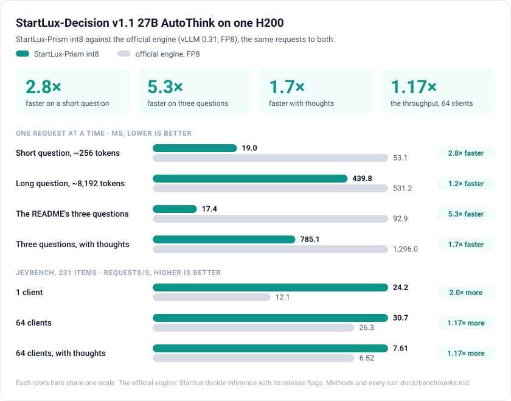
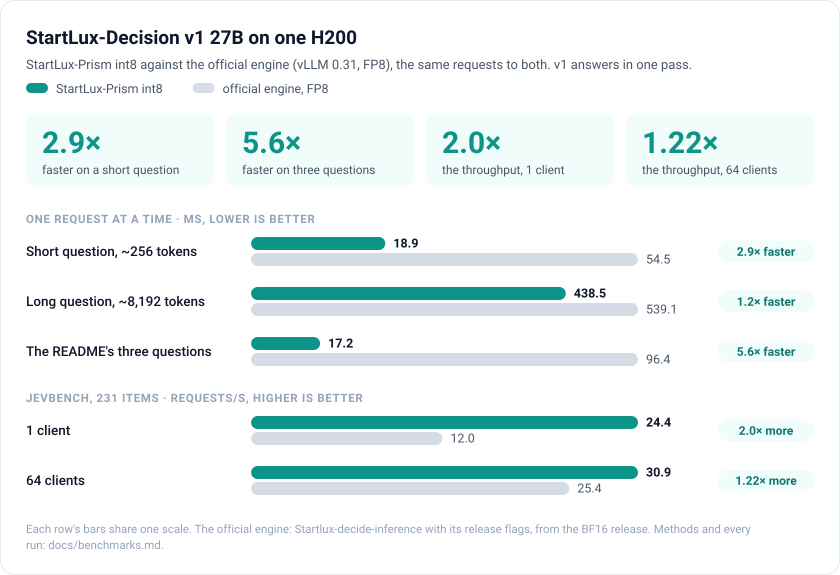
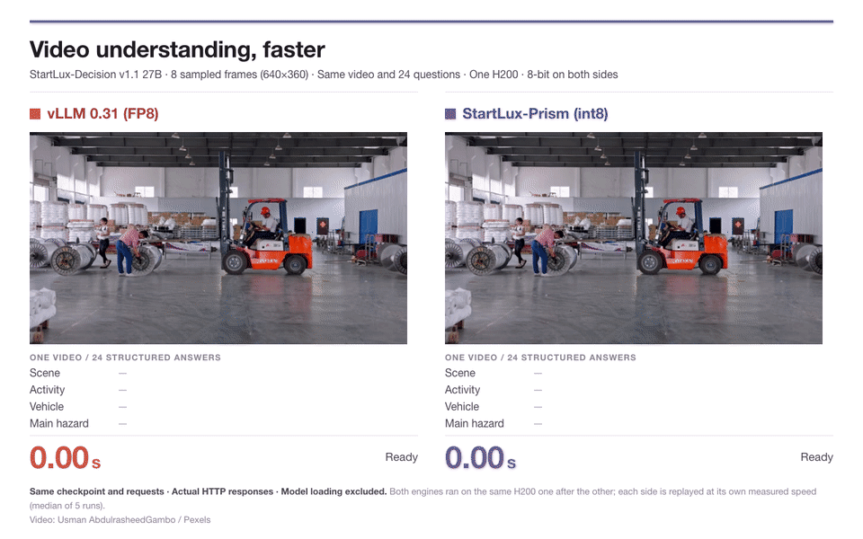
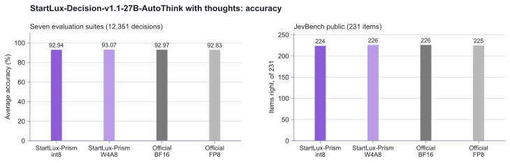

# StartLux-Prism

**Fast, exact inference for [StartLux-Decision](https://huggingface.co/startlux-models/collections) models on NVIDIA
GPUs.** StartLux-Prism serves StartLux-Decision v1 and v1.1 AutoThink (4B, 9B, 27B) straight from their released GGUF
files, behind the TypeSafe `/v1/systemone` API, on GPUs from Ampere to Blackwell, one or several. Like a prism that
splits light into its spectrum, it turns each question into a calibrated probability for every option.

**[Live comparison](#live-comparison-video-understanding)** · **[Installation](#installation)** · **[Quick start](#quick-start)** · **[Example](#example)** · **[Models and GPUs](#supported-models-and-gpus)** · **[Serving guide](docs/serving.md)** · **[Benchmarks](docs/benchmarks.md)**

<picture>
  <source media="(prefers-color-scheme: dark)" srcset="docs/images/v11-hero-dark.svg">
  
</picture>

<sub><b>StartLux-Decision-v1.1-27B-AutoThink on one H200: StartLux-Prism int8 against the official engine in FP8 (vLLM 0.31).</b></sub>

<picture>
  <source media="(prefers-color-scheme: dark)" srcset="docs/images/v1-hero-dark.svg">
  
</picture>

<sub><b>StartLux-Decision-v1-27B on one H200: StartLux-Prism int8 against the official engine in FP8 (vLLM 0.31).</b></sub>

## Live comparison: video understanding



The same StartLux-Decision v1.1 27B checkpoint answers **24 structured questions about one video in a single request**:
eight frames sampled from the clip (640x360), one H200, 8-bit on both sides. The official engine on vLLM 0.31 (FP8, its
launcher's flags) took **0.72 s**; StartLux-Prism int8 took **0.21 s** (**3.38x faster**).
Both engines ran on the same GPU, one after the other. The animation replays each at its measured speed: end-to-end
HTTP time, median of 5 runs, model loading excluded.
[Watch the MP4](docs/images/video-live-360p.mp4). Video: Usman AbdulrasheedGambo / Pexels.

## Why StartLux-Prism

- **Faster than the official engine.** Serving the 27B on one H200, StartLux-Prism answers a short question 2.8× and a
  three-question request 5.3× faster than StartLux-Decision's own engine in FP8 (vLLM 0.31), with 1.17× its throughput
  from 64 clients. Eight H200s serve 238 requests/s, against 138 for the official engine in BF16.
- **The official engine's accuracy.** Prompts, read-outs, thoughts and decision rules are the model's own; only the
  forward pass is new. On StartLux-Decision v1's seven evaluation suites, int8 scores 92.94 and W4A8 93.07, against
  92.97 for the official engine in BF16.
- **Reproducible to the bit.** int8 GEMMs sum exactly in int32, so a request receives the same probabilities whatever
  it is batched with, on any number of GPUs, from the prefix cache or not.
- **All of v1.1.** AutoThink thoughts are decoded on the GPU (95 tokens/s for one sequence, 3,832 for 64 at once);
  `none_probability`, `allow_none` and up to 8 images per request are supported.
- **The released files as they are.** Q8_0 files run as int8 (W8A8) and Q4_K_M files on their own 4-bit weights
  (W4A8), with no conversion step. In 4 bits the 27B runs on one 32 GB RTX 5090.
- **One GPU or several.** Data parallelism for throughput (3.92× on four H200s) and tensor parallelism (`--tp 2` or
  `4`) for latency.

## Experimental AMD support

A single-GPU ROCm W4A8 backend for R9700 (`gfx1201`) is available experimentally.
An explicit compressed [W4A16 profile](docs/amd_w4a16.md) passes the local FP32
readout checks and has separate performance/service evidence. Automatic Q4_K_M
precision remains W4A8; both profiles are experimental.
See [AMD setup and numerical limitations](docs/amd.md) and the
[measured R9700 acceleration report](docs/amd_acceleration.md). This does not extend
the NVIDIA accuracy or performance claims above to AMD.

## Installation

| Component | Requirement |
|---|---|
| OS | Linux |
| GPU | NVIDIA, Ampere or newer (sm_80 and later); see [Supported models and GPUs](#supported-models-and-gpus) |
| Driver | CUDA 13 (driver 580 or later), or CUDA 12 (driver 550 or 570) |
| Python | 3.12 with its headers and venv (`python3.12-dev python3.12-venv` on Ubuntu) |
| Compiler | `g++`: the CUDA kernels are compiled on the first start, for the GPU they run on |

With a CUDA 13 driver:

```bash
git clone https://github.com/StartLuxLabs/StartLux-Prism && cd StartLux-Prism
python3.12 -m venv .venv && source .venv/bin/activate
pip install -r requirements.txt     # PyTorch 2.14.1 for CUDA 13, Triton, nvcc 13.0
source scripts/cuda_env.sh          # nvcc from pip as CUDA_HOME (in every new shell)
```

With a CUDA 12 driver, replace the last two lines with PyTorch for CUDA 12.6 and a CUDA 12 toolkit's nvcc:

```bash
pip install -r requirements-cu12.txt
export CUDA_HOME=/usr/local/cuda    # a CUDA 12 toolkit (in every new shell)
```

### Models

A model directory holds the GGUF file and its release's folder files (`config.json`, `decision_config.json`, the
tokenizer and the chat template). The v1 GGUF repositories include them; for v1.1, take them from the full release:

```bash
M=~/models/StartLux-Decision-v1.1-27B-AutoThink-GGUF
hf download startlux-models/StartLux-Decision-v1.1-27B-AutoThink-GGUF StartLux-Decision-v1.1-27B-AutoThink-Q8_0.gguf --local-dir $M
hf download startlux-models/StartLux-Decision-v1.1-27B-AutoThink --exclude "*.safetensors" --local-dir $M   # tokenizer and config
```

Add the `mmproj-*.gguf` file to read images. The model weights are licensed CC BY-NC 4.0 (non-commercial).

## Quick start

Start a server:

```bash
G=$M/StartLux-Decision-v1.1-27B-AutoThink-Q8_0.gguf
python -m startlux_prism.server --gguf $G --model-dir $M --port 8092    # ready when it prints "Ready"
```

The server prints each loading step, then `Ready`, its endpoints and a request to try
([what a start prints](docs/serving.md#what-a-start-prints)). The first start measures the int8 activation ranges once
and keeps them in `~/.cache/startlux-prism/calib`.

### Several GPUs

The same flags apply, and every answer is bit-identical to the single-GPU one:

```bash
python -m startlux_prism.dp --gpus 0,1,2,3,4,5,6,7 --gguf $G --model-dir $M --port 8092   # data parallel: most throughput
python -m startlux_prism.server --tp 2 --gpus 0,1 --gguf $G --model-dir $M --port 8092    # tensor parallel: less latency
python -m startlux_prism.dp --gpus 0,1,2,3 --tp 2 --gguf $G --model-dir $M --port 8092    # both
```

### In production

The server has no authentication of its own: serve other machines (`--host 0.0.0.0`) only behind your own access
control. To keep the compiled kernels and the calibration across restarts, or to run the server under systemd, see
[Running as a service](docs/serving.md#running-as-a-service).

## Example

With the server running, ask one question:

```bash
curl -s localhost:8092/v1/systemone -H 'Content-Type: application/json' \
  -d '{"state": "I was charged twice and want a refund.", "questions": {"intent": {"type": "choice", "instructions": "Choose the customer intent.", "criteria": {"billing": "A payment or refund issue", "technical": "A malfunction or setup issue", "other": "Another request"}}}}'
```

The response holds `answers.intent.choice`, the most likely label, and `answers.intent.probabilities`, one per label.

Several questions about the same evidence go in one request and are answered in one
forward pass. Ask two questions about one ticket:

```bash
curl -s localhost:8092/v1/systemone -H 'Content-Type: application/json' -d '{
  "state": {"ticket": "I was charged twice for order #4411 and the app still shows it as unpaid."},
  "questions": {
    "team": {"type": "choice", "instructions": "Which team should handle this ticket?",
             "criteria": {"billing": "Payments and refunds", "shipping": "Delivery", "technical": "App and login"}},
    "urgent": {"type": "noul", "instructions": "Should this ticket be answered today?"}}}'
```

```text
{"answers": {"team": {"type": "choice", "choice": "billing", "confidence": 0.993, "probabilities": {...},
                      "none_probability": 0.002},
             "urgent": {"type": "noul", "noul": 0.749}},
 "usage": {"input_tokens": 191, "output_tokens": 0}, ...}
```

Both first read-outs reached the default gate (0.6), so the model answered without thinking. With `"gate": 0.9`, the
setting of the published numbers, `urgent` (0.749) falls below it: the model thinks for 29 tokens and answers 0.855.
`none_probability` is the probability that no listed option fits; the [serving guide](docs/serving.md) explains how to
act on it.

Ask about a video: sample eight frames, then send them as images (v1.1 with its `mmproj` file, up to 8 per request).
A string `state` places them at its `<image>` marks:

```bash
ffmpeg -i clip.mp4 -vf "fps=8/21,scale=640:360" frame%d.jpg    # eight frames from a 21-second clip, at 640x360
```

```python
import base64, json, urllib.request

frames = ["data:image/jpeg;base64," + base64.b64encode(open(f"frame{i}.jpg", "rb").read()).decode()
          for i in range(1, 9)]
body = {"state": "Eight frames sampled in order from one video of a work site: " + " ".join(["<image>"] * 8),
        "images": frames,
        "think_mode": "never",
        "questions": {
            "vehicle": {"type": "choice", "instructions": "Which vehicle is used?",
                        "criteria": {"forklift": "A sit-down forklift", "order picker": "A stand-up order picker",
                                     "none": "No vehicle"}},
            "pedestrian_near": {"type": "noul",
                                "instructions": "Is a person on foot within a few meters of the vehicle?"},
            "risk": {"type": "score", "instructions": "How risky is the situation overall?",
                     "criteria": ["Low", "Medium", "High"]}}}
req = urllib.request.Request("http://localhost:8092/v1/systemone", json.dumps(body).encode(),
                             {"Content-Type": "application/json"})
print(json.dumps(json.load(urllib.request.urlopen(req))["answers"], indent=1))
```

The [live comparison](#live-comparison-video-understanding) sends this kind of request, with 24 questions.

## Supported models and GPUs

| Model | Sizes | Files and precisions | Notes |
|---|---|---|---|
| StartLux-Decision v1 | 4B, 9B, 27B | Q8_0 as int8 (W8A8), Q4_K_M as W4A8 | One read-out per question |
| StartLux-Decision v1.1 AutoThink | 4B, 9B, 27B | Q8_0 as int8 (W8A8), Q4_K_M as W4A8 | Thoughts, `none_probability`, images |
| StartLux-Decision v1.1 Instant | 4B, 9B, 27B | Q8_0 as int8 (W8A8), Q4_K_M as W4A8 | One pass per question, the prompt read both ways (no shared evidence), images |

`--precision bf16` runs the same weights dequantized, on cuBLAS, as the reference for parity tests.

| GPU | Architecture | Status |
|---|---|---|
| H200 | Hopper, sm_90a | Tuned GEMM tables: int8 and W4A8 on warpgroup MMA with TMA (W4A8 from 128 rows) |
| RTX 5090 | Blackwell, sm_120 | Tuned GEMM tables: int8, W4A8 |
| A800 | Ampere, sm_80 | Tuned GEMM tables: int8, W4A8 |
| RTX 4090 | Ada, sm_89 | Tested without tables: int8 on the Triton kernel, W4A8 on its tile rule |

Data parallelism runs every precision; tensor parallelism runs the int8 path on 2 or 4 GPUs (measured on H200s). The
models and files measured on each GPU: [Models, GPUs and precisions](docs/serving.md#models-gpus-and-precisions).

## Serving

Endpoints: `POST /v1/systemone` (also `/v1/decisions`), `GET /v1/models`, `GET /health` and `GET /stats`.

| Request field | Default | Description |
|---|---|---|
| `state`, `questions` | | The evidence (text or JSON) and typed questions: `choice`, `noul` (yes/no), `score` |
| `images` | | Up to 8, base64 or data URIs |
| `think_mode` | `auto` | `auto` thinks when the first read-out's top probability is below `gate`; `never`; `always` |
| `gate`, `mix`, `think_budget` | 0.6, 0.75, 4,096 | The threshold to think (the published numbers use 0.9), the weight of the read-out after the thought, the longest thought |
| `none_check`, `allow_none` | on, on (v1.1) | "None of the above" as an extra option, reported as `none_probability`; a null choice when it is the most likely option |
| `return_details`, `return_thought` | off | Each answer's read-outs and timings; the thought's text |

| Server flag | Default | Description |
|---|---|---|
| `--precision` | `auto` | `int8` for Q8_0 files, `w4a8` for Q4_K_M files, `bf16` as the reference; `w4a16` is an explicit experimental ROCm option |
| `--gpus`, `--tp` | | The GPUs; the GPUs per model (2 or 4 for the 27B) |
| `--max-tokens` | from free memory | The largest batch (131,072 tokens for the 27B on an H200); longer requests get HTTP 422 |
| `--prefix-cache-tokens` | 65,536 | KV rows kept for evidence that comes again |
| `--think-seqs` | as many as fit | Thoughts generated at once (64 for the 27B on an H200, 16 for the 9B in int8 on an RTX 5090) |
| `--kv-fp8` | off | Keys and values as e4m3 with a scale per token and KV head (sm_89 or newer): about half the KV memory, so more thoughts and cached evidence fit |
| `--gate`, `--none-check`, `--allow-none` | 0.6, on, on (v1.1) | The defaults of the request fields |

Every field, flag and model folder: [serving guide](docs/serving.md).

## Performance

The 27B on one H200 per server, against the official engine (Startlux-decide-inference on vLLM 0.31) on the same
requests. Latency is the mean over requests sent one at a time.

**StartLux-Decision-v1.1-27B-AutoThink**

| | Official, BF16 | Official, FP8 | **StartLux-Prism, int8** |
|---|---:|---:|---:|
| One short question (ms) | 54.2 | 53.1 | **19.0** |
| Three questions (ms), with thoughts in parentheses | 93.1 (1,775) | 92.9 (1,296) | **17.4 (785)** |
| One question of 8,192 tokens (ms) | 728.8 | 531.2 | **439.8** |
| JevBench read-outs from 64 clients (requests/s) | 18.3 | 26.3 | **30.7** |
| JevBench with thoughts from 64 clients (requests/s) | 5.89 | 6.52 | **7.61** |

**StartLux-Decision-v1-27B** (v1 answers in one pass)

| | Official, BF16 | Official, FP8 | **StartLux-Prism, int8** |
|---|---:|---:|---:|
| One short question (ms) | 54.7 | 54.5 | **18.9** |
| Three questions (ms) | 95.4 | 96.4 | **17.2** |
| One question of 8,192 tokens (ms) | 727.2 | 539.1 | **438.5** |
| JevBench read-outs from 64 clients (requests/s) | 18.1 | 25.4 | **30.9** |

Under load both engines are bound by the tensor cores, which run int8 and FP8 at the same rate, so the lead narrows to
17% on v1.1 and 22% on v1. On several H200s, v1.1 serves 30.9 read-outs per second on one GPU, 121.1 on four and 237.8
on eight (the official engine on eight: 137.5).

Against every other engine compared on v1 (SGLang, vLLM, llama.cpp, StartLux-Decision's PyTorch server, decider and
JevK5), StartLux-Prism has the lowest latency (1.6-2.3× below the next) and 1.6-2.4× their throughput. Methods, every
engine and the raw numbers: [benchmarks](docs/benchmarks.md).

## Accuracy

StartLux-Decision-v1.1-27B-AutoThink with thoughts: StartLux-Prism int8 from the Q8_0 file, and W4A8 from the Q4_K_M
file on one RTX 5090, against the official engine on the BF16 release.

<picture>
  <source media="(prefers-color-scheme: dark)" srcset="docs/images/v11-accuracy-dark.svg">
  
</picture>

<sub><b>StartLux-Decision-v1.1-27B-AutoThink with thoughts: accuracy.</b></sub>

On StartLux-Decision v1's own evaluation (12,351 decisions), int8 averages 91.14 against the reference's 91.15 on the
4B, and 90.80 against 91.06 on the 9B. About 1% of the decisions change, all near ties, and calibration does not move.
Every suite: [benchmarks](docs/benchmarks.md#accuracy-startlux-decision-v1s-evaluation).

## How it works

- **One forward pass per batch, as CUDA graphs.** A request's questions branch off their shared evidence inside the
  graph, so the evidence is computed once.
- **A prefix cache** keeps evidence across requests: a follow-up question takes 5.4 ms instead of 54.
- **int8 tensor cores with exact int32 sums**, so an answer does not depend on its batch, the number of GPUs or the
  cache.
- **Kernels chosen per GPU** from measured tables. On Hopper the int8 GEMMs run on warpgroup MMA at 1,240-1,420 TOPS,
  W4A8's from 128 rows at 406-430.
- **Thoughts decoded on the GPU** in CUDA graphs, between prefill batches, seeded per question.

## Documentation

| Document | Contents |
|---|---|
| [Serving guide](docs/serving.md) | Every request field and server flag, model folders, precisions, several GPUs, running as a service |
| [Benchmarks](docs/benchmarks.md) | Methods, setups and results against the official engine and six other engines |
| [Design](docs/design.md) | How the engine works, with a map of the code |
| [Optimization log](docs/optimizations.md) | What was measured, kept and dropped |
| [Correctness and tests](docs/testing.md) | How answers are checked against the reference, and how to run the tests |

## Acknowledgements

- [StartLux-Decision](https://github.com/StartLuxLabs/StartLux-Decision): the models. StartLux-Prism vendors its prompt
  format (`startlux_prism/jevfmt.py`) and int8 calibration requests (`calibration.py`), and the thought loop detector
  of its v1.1 package (`loops.py`).

## License

StartLux-Prism's own code does not have a license yet; it will be chosen by the owner. The files vendored from
StartLux-Decision (`startlux_prism/jevfmt.py`, `startlux_prism/calibration.py`, `startlux_prism/loops.py`) are under
Apache-2.0 ([LICENSES/StartLux-Decision-Apache-2.0.txt](LICENSES/StartLux-Decision-Apache-2.0.txt)). Model weights are
not part of this repository; StartLux-Decision's weights are CC BY-NC 4.0 (non-commercial).
