# Benchmarks and stress tests

StartLux-Prism against seven other engines on StartLux-Decision v1 at 4B, 9B and 27B (StartLux's Q8_0 and Q4_K_M GGUF
releases, byte-identical to them: [Setup](#setup)): one request at a time, many clients at
once, long evidence, follow-up questions served from a prefix cache, the longest request each engine computes in one
pass, and the stress test of a running server. Two machines: an RTX 5090 (the 4B, the 9B and the 27B's Q4_K_M file)
and an H200 (the 27B). Every engine runs alone on the GPU, one after another, through the same HTTP client; the v1
numbers are from 2026-10-10 to 2026-10-12. Then StartLux-Decision v1.1 27B AutoThink on a second H200 server
(2026-10-13 and 14): thoughts (its Q8_0 and Q4_K_M files, and the 9B's Q4_K_M), its official engine, int8 against
bf16, images, and several GPUs (data parallelism,
tensor parallelism, both; eight GPUs against the official engine). Each chart is drawn from the table below it (`python bench/charts.py`).

- [Summary](#summary)
- [Setup](#setup) · [Method](#method) · [Reproducing](#reproducing)
- [StartLux-Decision-v1-4B on an RTX 5090](#startlux-decision-v1-4b-on-an-rtx-5090): [one request at a time](#one-request-at-a-time),
  [many clients](#many-clients-at-once), [long evidence](#long-evidence-8k-and-50k-tokens),
  [prefix cache](#follow-up-questions-the-prefix-cache)
- [StartLux-Decision-v1-9B on an RTX 5090](#startlux-decision-v1-9b-on-an-rtx-5090)
- [StartLux-Decision-v1-27B on an H200](#startlux-decision-v1-27b-on-an-h200)
- [Q4_K_M files: W4A8](#q4_k_m-files-w4a8)
- [The longest request in one pass](#the-longest-request-in-one-pass)
- [Accuracy: StartLux-Decision-v1's evaluation](#accuracy-startlux-decision-v1s-evaluation)
- [StartLux-Decision v1.1 27B AutoThink: thinking](#startlux-decision-v11-27b-autothink-thinking)
- [StartLux-Decision v1.1 27B AutoThink against its official engine](#startlux-decision-v11-27b-autothink-against-its-official-engine)
- [Images](#images)
- [Several GPUs: data parallelism](#several-gpus-data-parallelism)
- [Tensor parallelism: the 27B on 2 and 4 H200s](#tensor-parallelism-the-27b-on-2-and-4-h200s)
- [Four H200s: the most throughput](#four-h200s-the-most-throughput)
- [Eight H200s: against the official engine](#eight-h200s-against-the-official-engine)
- [Stress tests](#stress-tests)
- [Engine configurations](#engine-configurations) · [Crashes on the RTX 5090 server](#crashes-on-the-rtx-5090-server)

## Summary

Every engine on all three models: StartLux-Decision-v1-4B and -9B on the RTX 5090, -27B on the H200, each from its Q8_0
file (`StartLux-Decision-4B-Q8_0.gguf`, `-9B-Q8_0.gguf`, `-27B-Q8_0.gguf`; [Setup](#setup)). decider and JevK5 run
StartLux's weights as same-shape stand-ins (they ship no StartLux checkpoint), so their speed compares directly but
their scores, in parentheses, come from prompts these weights were not trained with.

<picture>
  <source media="(prefers-color-scheme: dark)" srcset="images/jevbench-latency-dark.svg">
  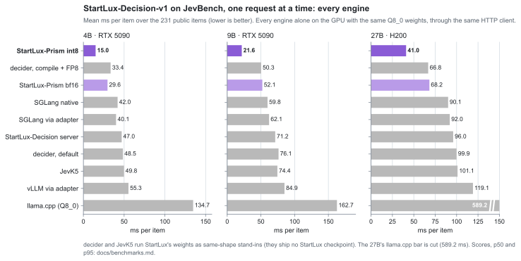
</picture>

<picture>
  <source media="(prefers-color-scheme: dark)" srcset="images/jevbench-throughput-dark.svg">
  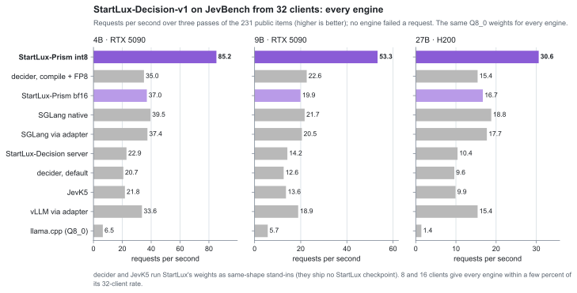
</picture>

**JevBench** (the 231 public items):

| engine | mean / p50 / p95 ms per item, one at a time: 4B · 9B · 27B | requests/s from 32 clients (4B / 9B / 27B) | score, of 231 (4B / 9B / 27B) |
|---|---|---|---|
| **StartLux-Prism int8** | **15.0 / 5.5 / 53 · 21.6 / 8.0 / 76 · 41.0 / 14.2 / 146** | **85.2 / 53.3 / 30.6** | 205 / 200 / 207 |
| StartLux-Prism bf16 | 29.6 / 8.5 / 116 · 52.1 / 12.8 / 210 · 68.2 / 19.4 / 267 | 37.0 / 19.9 / 16.7 | 205 / 201 / 209 |
| decider 1.9.0, torch.compile + FP8 | 33.4 / 13.7 / 110 · 50.3 / 23.8 / 164 · 66.8 / 26.2 / 222 | 35.0 / 22.6 / 15.4 | (199 / 202 / 206) |
| SGLang 0.5.21, native `/v1/systemone` | 42.0 / 20.6 / 135 · 59.8 / 22.3 / 214 · 90.1 / 57.7 / 244 | 39.5 / 21.7 / 18.8 | 196 / 199 / 211 |
| SGLang 0.5.21, via adapter | 40.1 / 19.1 / 128 · 62.1 / 26.4 / 212 · 92.0 / 58.8 / 247 | 37.4 / 20.5 / 17.7 | 205 / 201 / 209 |
| StartLux-Decision server | 47.0 / 16.6 / 173 · 71.2 / 24.4 / 261 · 96.0 / 37.3 / 339 | 22.9 / 14.2 / 10.4 | 204 / 201 / 209 |
| decider 1.9.0, default | 48.5 / 20.2 / 172 · 76.1 / 33.7 / 280 · 99.9 / 37.8 / 352 | 20.7 / 12.6 / 9.6 | (199 / 202 / 208) |
| JevK5 0.3.3 | 49.8 / 18.2 / 173 · 74.4 / 28.4 / 260 · 101.1 / 39.6 / 341 | 21.8 / 13.6 / 9.9 | (202 / 199 / 211) |
| vLLM 0.31, via adapter | 55.3 / 26.8 / 166 · 84.9 / 38.6 / 271 · 119.1 / 72.3 / 305 | 33.6 / 18.9 / 15.4 | 205 / 201 / 209 |
| llama.cpp b10639 (Q8_0) | 134.7 / 90.0 / 314 · 162.7 / 95.7 / 399 · 589.2 / 359.6 / 1431 | 6.5 / 5.7 / 1.4 | 205 / 200 / 209 |

The model cards give 204 (4B), 200 (9B) and 209 (27B); on their own 4B checkpoints decider scores 194 (FP8) and 193,
JevK5 202. SGLang's native endpoint renders its own prompts too.

**Single requests and long evidence** (p50 ms, one request at a time):

| engine | StartLux's 3-question request (4B / 9B / 27B) | 8,000 tokens of evidence (4B / 9B / 27B) | 50,000 tokens of evidence (4B / 9B / 27B) |
|---|---|---|---|
| **StartLux-Prism int8** | **10.20 / 15.50 / 25.01** | **162.5 / 244 / 432** | **1,960 / 2,582 / 3,693** |
| StartLux-Prism bf16 | 19.06 / 29.84 / 38.60 | - | - |
| decider, torch.compile + FP8 | 75.18 / 111.56 / 158.57 | 328.7 / 458 / 698 | 3,708 / 4,925 / 7,301 |
| SGLang, native | 47.55 / 73.98 / 97.93 | - | - |
| SGLang, via adapter | 49.29 / 81.50 / 95.48 | 342.2 / 603 / 704 | 2,911 / 4,515 / 4,936 |
| StartLux-Decision server | 49.89 / 89.56 / 108.23 | 424.2 / 699 / 870 | fails above 32,768 tokens |
| decider, default | 115.77 / 200.75 / 271.83 | 521.5 / 799 / 1,062 | 3,272 / out of memory / 6,779 |
| JevK5 | 80.98 / 123.53 / 149.94 | 417.7 / 690 / 847 | 3,263 / 5,031 / 5,783 |
| vLLM, via adapter | 74.19 / 111.01 / 175.80 | 440.5 / 702 / 833 | 3,359 / 5,039 / 5,743 |
| llama.cpp | 313.35 / 346.41 / 1,308.49 | 730.3 / 926 / 3,514 | 5,326 / 6,406 / 28,623 |

**Under load** (requests/s; no engine failed a request in any of the many-client runs):

| engine | mixed suites, best over 1-64 clients (4B / 9B / 27B) | 8k-token requests from 32 clients (4B / 9B / 27B) |
|---|---|---|
| **StartLux-Prism int8** | **294 / 182 / 100** | **6.05 / 4.01 / 2.33** |
| StartLux-Prism bf16 | 124 / 68 / 56 | - |
| decider, torch.compile + FP8 | 43 / 25 / 17 | 3.07 / 2.23 / 1.43 |
| SGLang, native | 82 / 45 / 38 | - |
| SGLang, via adapter | 70 / 39 / 32 | 2.95 / 1.67 / 1.47 |
| StartLux-Decision server | 42 / 29 / 19 | 2.35 / 1.42 / 1.14 |
| decider, default | 22 / 13 / 10 | 1.90 / 1.24 / 0.95 |
| JevK5 | 31 / 20 / 13 | 2.38 / 1.43 / 1.17 |
| vLLM, via adapter | 64 / 36 / 27 | 2.60 / 1.52 / 1.26 |
| llama.cpp | 7 / 6 / 2 | 1.36 / 1.08 / 0.28 |

"-": not run (the long-evidence runs take one configuration per engine; StartLux-Prism's 9B ran them with `--prefix-cache 0`, its largest batch then 65,536 tokens). StartLux-Prism's `tests/test_stress.py` passed all
11 checks in every run: int8 and W4A8, on the RTX 5090 and the H200 ([Stress tests](#stress-tests)).

**Accuracy** on StartLux-Decision-v1's own evaluation (the seven Intern-Decision suites, 12,351 decisions), against
StartLux-Decision's own server on the same weights: StartLux-Prism int8 averages 91.14 against 91.15 (4B) and 90.80 against
91.06 (9B), bf16 91.26 and 91.05; [Accuracy](#accuracy-startlux-decision-v1s-evaluation).

## Setup

**RTX 5090 server.** NVIDIA GeForce RTX 5090 (32 GB, 170 SMs, driver 580.173.02, CUDA 13.0), Intel Core Ultra 9 285K,
Ubuntu 24.04, with **the GPU to itself**: the other tenant's process (ComfyUI, 9.85 GB) was stopped first, and before
every engine the driver script checked that no other process computed on the GPU (`scripts/compare.sh`). Every result
file records the GPU's processes, clocks, power and temperature. The 4B tables are from 2026-10-10 (standard comparison
13:24-14:34, long evidence 13:59-14:44, longest request without chunked prefill 14:44-15:25, many clients
15:32-17:00); a first full comparison on 2026-10-09 (13:45-14:52) gave every engine's numbers within a few percent.

**H200 server.** One NVIDIA H200 (141 GB HBM3e, 132 SMs, driver 590.48.01, CUDA 13 runtime from pip), Intel Xeon
Platinum 8558 (192 threads), Ubuntu 22.04, 2026-10-12. The machine is shared: other users' vLLM servers ran on 4-6 of
its 8 GPUs the whole day. Every engine ran alone on one GPU (GPU 5; `compare.sh` checked before each engine that no
other process computed on it, and the result files record its processes), one after another: the baselines
10:34-15:13, StartLux-Prism 16:36-17:42. The same package versions as the RTX 5090 server's, llama.cpp the same build
(b10639, for sm_90), the same scripts and flags.

**Models.** StartLux-Decision v1, StartLux's GGUF releases on Hugging Face (published 2026-09-29), unchanged. Every
file run here is byte-identical to the release: the SHA-256 of each file on the servers, computed on 2026-10-13, equals
the one Hugging Face lists for it. The repositories were named `StartLux-Decision-<size>-<precision>-GGUF` when we
downloaded them (2026-10-08 to 2026-10-11) and now carry a `v1`; the old names redirect.

| Model | File (Hugging Face repository) | Size | SHA-256 | Run on |
|---|---|---|---|---|
| StartLux-Decision-v1-4B | [`StartLux-Decision-4B-Q8_0.gguf`](https://huggingface.co/startlux-models/StartLux-Decision-v1-4B-Q8_0-GGUF) | 4.48 GB | `3de47f14ca2807813a670d697e70815fbecf020732ca4d7fc5f2e6c3898e34df` | RTX 5090 |
|  | [`StartLux-Decision-4B-Q4_K_M.gguf`](https://huggingface.co/startlux-models/StartLux-Decision-v1-4B-Q4_K_M-GGUF) | 2.71 GB | `36c2aec2c3741f0602b0d931273c1f55a7a8650bdb0be8d4adc9848a19b34b30` | RTX 5090 |
| StartLux-Decision-v1-9B | [`StartLux-Decision-9B-Q8_0.gguf`](https://huggingface.co/startlux-models/StartLux-Decision-v1-9B-Q8_0-GGUF) | 9.53 GB | `9daae5054f92c3d17d764f8aeaaede1d681d5659c65735165f04698ea9c32ffe` | RTX 5090 |
|  | [`StartLux-Decision-9B-Q4_K_M.gguf`](https://huggingface.co/startlux-models/StartLux-Decision-v1-9B-Q4_K_M-GGUF) | 5.63 GB | `d2757a83badaa8baee0cda0aaf0e2eab131785322c169f19accc169a3df36ef2` | RTX 5090 |
| StartLux-Decision-v1-27B | [`StartLux-Decision-27B-Q8_0.gguf`](https://huggingface.co/startlux-models/StartLux-Decision-v1-27B-Q8_0-GGUF) | 28.60 GB | `5868a8a2df103c63353adfbda6f57fec5b6393c9b8a1d97392855a0335001088` | H200 |
|  | [`StartLux-Decision-27B-Q4_K_M.gguf`](https://huggingface.co/startlux-models/StartLux-Decision-v1-27B-Q4_K_M-GGUF) | 16.55 GB | `7c23c38501989d30bdde77a0a6d434aa8de08f675ff6b511835d0c6fe03f146a` | RTX 5090, H200 |

**Weights.** Each model from its Q8_0 GGUF; every engine runs the weights of that one file. StartLux-Prism and llama.cpp
read the GGUF: llama.cpp computes with its Q8_0 blocks; StartLux-Prism bf16 dequantizes them, and StartLux-Prism int8 requantizes
them at start-up to W8A8 (SmoothQuant, one scale per output row; activations quantized per token; a few seconds on the
GPU, no separate conversion step). The transformers-based engines (StartLux-Decision's own server, SGLang, vLLM,
decider, JevK5) run the same weights converted once to bf16 safetensors by `startlux_prism/tools/gguf_to_hf.py` (Q8_0 values
dequantized exactly, then rounded to bf16; validated with StartLux-Decision's code). Precision per engine: StartLux-Prism
int8 W8A8; llama.cpp the Q8_0 weights as stored; decider with `DECIDER_FP8=1` FP8 linear layers; everything else bf16.
The Q4_K_M files: [their own section](#q4_k_m-files-w4a8).

**Engines.** llama.cpp b10639 behind StartLux-Decision's GGUF server (the official path for these files),
StartLux-Decision's PyTorch server, SGLang 0.5.21 (through a StartLux-format adapter, and its native `/v1/systemone`),
vLLM 0.31, and the JEV-specific runtimes Mapika decider 1.9.0 (default, and torch.compile + FP8) and JevK5 0.3.3. Flags:
[Engine configurations](#engine-configurations). Not included: NInfer (a C++/CUDA engine built for the RTX 5090's
architecture, which ships 27B / 35B-A3B models only), typecastlm, Imajev.

## Method

* **Same client, same requests, same answers.** Every engine is measured through `/v1/systemone` over loopback HTTP with
  one client (`bench/run_http.py`: persistent connection, TCP_NODELAY). SGLang and vLLM have no StartLux-format
  `/v1/systemone`, so `bench/adapters/framework_systemone.py` puts StartLux-Decision's prompts, letter readout,
  temperatures, wide-choice rounds and answer format in front of them (SGLang: one `/v1/score` call per request, the
  questions' common prefix as the query; vLLM: one chat completion per question with `logprob_token_ids` = the 26
  letters, sent concurrently). SGLang's own native `/v1/systemone` (its own prompt rendering) is listed too. decider and
  JevK5 serve `/v1/systemone` themselves, with their own prompt formats.
* **Unique requests.** Every request carries a 6-digit request number at the start of its evidence
  (`run_http.uniquify`, the same token count for every copy), so no engine can replay a cached prefix of the previous
  identical request: SGLang's radix cache, vLLM's prefix cache and llama.cpp's slot cache all did on repeated requests,
  which made a 2,170-token request look like 17 ms on SGLang. Real decision traffic brings new evidence each time.
* **Latency:** per suite, 20 warm-up requests then 100 timed ones at concurrency 1; p50 reported. Suites: StartLux's
  published `eval/latency.py` requests (StartLux-Decision repository; `startlux3`: choice + yes/no + score on one
  ticket, 927 tokens over the three prompts in StartLux's format; `startlux1`: its single yes/no), and the sample
  requests of StartLuxLabs' StartLux-Decision-inference (`readme3` is the README / server demo request, `yesno` its
  yes/no question alone, as in that repository's benchmark; `longpage2` 2,194 tokens over two questions, `wide33` a
  33-option choice, `review1` a 5-level score, from its agreement checks). All seven are verbatim apart from the unique
  tag; none has graded answers, so they measure speed only (JevBench measures accuracy).
* **Throughput:** closed loop, c clients sending the mix (startlux3, startlux1, readme3, yesno, review1) back to back
  for 15 s per concurrency level (1, 4, 16, 64).
* **Many clients at once:** JevBench's 231 items from 8, 16 and 32 clients (three passes per level, each in its own
  fixed shuffled order, the same for every engine), and 8k-token requests from 8, 16 and 32 clients for 30 s per level;
  requests/s over the level's wall time.
* **Accuracy:** the 231 public JevBench items, scored with JevBench's scorer at commit 7ce310c7 (as StartLux-Decision
  does), one request per item in file order, after a warm-up pass over request-numbered copies of every item (every
  prompt shape seen, nothing cached).
* **decider and JevK5** ship no StartLux checkpoint: they run StartLux-Decision's weights as a same-shape stand-in (same
  architecture and sizes, so the same arithmetic per token), and on the 4B also their own checkpoints (Mapika/decider-4b
  v2; JevK5 v0.3, its Q8_0 GGUF dequantized to bf16 by `gguf_to_hf`), which gives their own JevBench scores. Each renders
  its own prompts, so the token counts differ from StartLux's (decider: 459 tokens for startlux3, JevK5: 1,054). Scores
  in parentheses below come from a checkpoint the engine was not trained with (stand-in runs measure speed only).

## Reproducing

Everything on this page runs on the GPU server with `scripts/stress.sh`: each engine alone on the GPU, one after
another; an entry whose server crashed is rerun up to twice. Steps: 0 the standard comparison, 1 JevBench from 8, 16
and 32 clients, 2 long evidence, 3 8k-token requests from 8, 16 and 32 clients, 4 the longest request without chunked
prefill (`scripts/max_context.sh`), 5 `tests/test_stress.py`. Then `python bench/report.py` prints the first table,
`--long` and `--stress` the others; `python bench/charts.py` draws the charts. Engine flags are in
`scripts/baselines.sh`. Another model: `scripts/prepare_model.sh` (its folders for every engine) and
`scripts/new_model.sh` (dispatch table entries, int8 calibration, correctness tests), then `scripts/stress.sh` with the
environment prepare_model.sh prints. The Q4_K_M rows: `MODEL=<the Q4_K_M repository> TAG=-q4km-4B scripts/compare.sh
startlux-prism-w4a8 llamacpp sglang-gguf` (sglang-gguf with that model's CAUSAL_FLAT); the W4A8 GEMM's table:
`bench/w4a8_table.py` over the Q4_K_M files.

## StartLux-Decision-v1-4B on an RTX 5090

The model: StartLux-Decision-v1-4B, `StartLux-Decision-4B-Q8_0.gguf` (4.48 GB, SHA-256 `3de47f14…`), for every engine
(the PyTorch engines on its bf16 conversion); the Q4_K_M rows further down: `StartLux-Decision-4B-Q4_K_M.gguf`.

### One request at a time

<picture>
  <source media="(prefers-color-scheme: dark)" srcset="images/rtx5090-4b-dark.svg">
  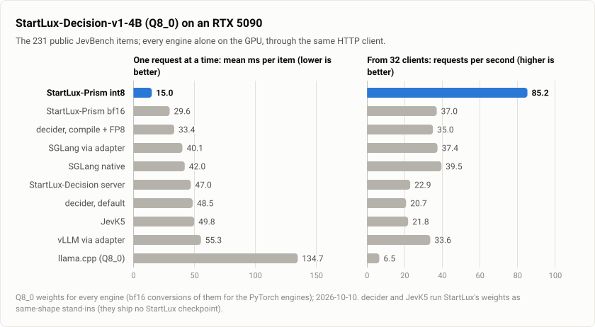
</picture>

p50 latency (ms) at concurrency 1, best throughput of the sweep (requests/s, at concurrency c), JevBench score and
per-item latency (mean / p50 / p95 ms):

| engine | startlux3 | startlux1 | readme3 | yesno | longpage2 | wide33 | review1 | max req/s (c) | JevBench | JevBench mean / p50 / p95 |
|---|---|---|---|---|---|---|---|---|---|---|
| **StartLux-Prism int8** (W8A8) | **10.20** | **9.40** | **6.63** | **5.08** | **24.65** | **11.98** | **5.30** | **294 (64)** | **205/231** | **15.0 / 5.5 / 53** |
| StartLux-Prism bf16 | 19.06 | 16.29 | 11.63 | 9.06 | 50.85 | 20.43 | 9.02 | 124 (64) | 205/231 | 29.6 / 8.5 / 116 |
| decider 1.9.0, compile + FP8, stand-in weights | 75.18 | 16.15 | 30.30 | 10.01 | 93.58 | 17.00 | 34.54 | 43 (16) | (199) | 33.4 / 13.7 / 110 |
| decider 1.9.0, compile + FP8, own checkpoint | 65.20 | 15.96 | 30.24 | 9.97 | 93.40 | 15.79 | 30.31 | 40 (64) | 194/231 | 33.7 / 15.2 / 112 |
| decider 1.9.0, default (bf16), stand-in weights | 115.77 | 26.45 | 56.31 | 15.38 | 99.48 | 27.08 | 56.14 | 22 (4) | (199) | 48.5 / 20.2 / 172 |
| decider 1.9.0, default (bf16), own checkpoint | 115.85 | 25.86 | 53.83 | 15.46 | 99.58 | 27.23 | 56.21 | 22 (64) | 193/231 | 48.8 / 20.2 / 173 |
| JevK5 0.3.3 (bf16), stand-in weights | 80.98 | 26.64 | 48.11 | 16.47 | 156.23 | 81.07 | 16.50 | 31 (64) | (202) | 49.8 / 18.2 / 173 |
| JevK5 0.3.3 (bf16), own checkpoint | 81.16 | 26.57 | 47.03 | 16.53 | 157.85 | 81.07 | 16.52 | 31 (4) | 202/231 | 49.6 / 18.1 / 173 |
| StartLux-Decision server (bf16; torch, fla, CUDA graphs) | 49.89 | 23.57 | 26.42 | 12.01 | 130.07 | 37.79 | 12.05 | 42 (64) | 204/231 | 47.0 / 16.6 / 173 |
| SGLang 0.5.21 (bf16, via adapter) | 49.29 | 28.46 | 32.54 | 18.91 | 105.09 | 41.11 | 19.03 | 70 (64) | 205/231 | 40.1 / 19.1 / 128 |
| SGLang 0.5.21 native `/v1/systemone` (bf16) | 47.55 | 24.15 | 25.55 | 18.11 | 112.17 | 32.54 | 18.05 | 82 (64) | 196/231 | 42.0 / 20.6 / 135 |
| vLLM 0.31 (bf16, via adapter) | 74.19 | 33.38 | 43.34 | 25.72 | 124.21 | 64.93 | 24.78 | 64 (64) | 205/231 | 55.3 / 26.8 / 166 |
| llama.cpp b10639 (Q8_0) + StartLux GGUF server | 313.35 | 90.50 | 266.42 | 81.60 | 374.39 | 256.12 | 85.19 | 7 (4) | 205/231 | 134.7 / 90.0 / 314 |

StartLux-Prism int8 against the best other engine on each measurement: startlux3 4.7x (47.6 ms, SGLang native), startlux1
1.7x (16.0, decider compile+FP8), readme3 3.9x (25.6, SGLang native), yesno 2.0x (10.0, decider compile+FP8),
longpage2 3.8x (93.4, decider compile+FP8), wide33 1.3x (15.8, decider compile+FP8), review1 2.3x (12.1, StartLux),
throughput 3.6x (82, SGLang native), JevBench mean 2.2x (33.4, decider compile+FP8), p50 2.5x (13.7, same), p95 2.1x
(110, same). StartLux-Prism bf16, at the other engines' precision: startlux3 2.5x, readme3 2.2x, longpage2 2.0x, throughput
1.5x, JevBench mean 1.4x against the best bf16 engine on each.

**Accuracy and agreement.** StartLux-Decision publishes 204/231 for this checkpoint. On the 231 JevBench items, the
engines running StartLux's weights make the same decision as StartLux's own server on: StartLux-Prism bf16 231 (largest
probability difference 0.027), llama.cpp 230, vLLM 229, StartLux-Prism int8 228 (three near-ties flip; largest difference
0.13; its score is 205). StartLux-Prism int8 is deterministic and batch-invariant: a request gets bit-identical
probabilities on every run, whatever other requests share its batch and whether its evidence came from the prefix
cache (`tests/test_engine.py --repeat`, `tests/test_prefix_cache.py --exact`; how: `docs/optimizations.md`). The bf16
path is deterministic run to run but not batch-invariant (cuBLAS picks its kernels by batch size). SGLang's native
endpoint renders its own prompt, not the one the checkpoint was trained on, hence 196.

JevBench latency by prompt length (mean ms per item; length in StartLux's prompt format):

| prompt tokens | items | StartLux-Prism int8 | decider compile+FP8 (stand-in) | decider (own) | JevK5 (own) | StartLux | SGLang | SGLang native | vLLM | llama.cpp |
|---|---|---|---|---|---|---|---|---|---|---|
| < 200 | 121 | **5.4** | 10.7 | 14.1 | 16.7 | 13.7 | 20.4 | 16.1 | 25.1 | 91.7 |
| 200-500 | 43 | **9.0** | 15.1 | 21.7 | 26.5 | 24.0 | 25.8 | 27.7 | 35.7 | 103.2 |
| 500-1,000 | 24 | **15.4** | 25.9 | 40.5 | 47.5 | 43.2 | 41.8 | 41.8 | 63.1 | 154.7 |
| 1,000-2,000 | 7 | **27.2** | 42.5 | 65.1 | 84.3 | 80.1 | 69.3 | 66.9 | 89.1 | 193.4 |
| 2,000-4,000 | 36 | **57.7** | 115.2 | 168.1 | 183.7 | 183.4 | 133.2 | 130.7 | 171.2 | 311.1 |

### Many clients at once

**JevBench from 8, 16 and 32 clients** (`bench/run_jevbench.py --conc 8,16,32 --passes 3`, `BENCH=jevconc`; the
standard comparison's engine settings): after the warm-up pass, the clients send three passes over the 231 public items
(each pass in its own fixed shuffled order, the same for every engine, every request with its own request number) as
fast as answers come back. Requests per second over the level's wall time (p50 latency in ms), and each pass's score
at 32 clients. No engine failed a request. The request number in front of the evidence moves near-ties, so a pass
scores within 3 of the engine's sequential score.

| engine | 8 clients | 16 clients | 32 clients | score per pass (32 clients) |
|---|---|---|---|---|
| **StartLux-Prism int8** | **85.1 (86)** | **85.5 (176)** | **85.2 (356)** | 206 / 204 / 203 |
| SGLang 0.5.21 native `/v1/systemone` | 36.8 (206) | 38.7 (397) | 39.5 (816) | 195 / 196 / 195 |
| StartLux-Prism bf16 | 36.3 (211) | 36.5 (428) | 37.0 (853) | 204 / 203 / 203 |
| SGLang 0.5.21 (via adapter) | 35.2 (210) | 36.9 (424) | 37.4 (821) | 204 / 203 / 204 |
| decider 1.9.0, compile + FP8, own checkpoint | 35.7 (204) | 36.7 (413) | 35.2 (891) | 192 / 192 / 190 |
| decider 1.9.0, compile + FP8, stand-in weights | 35.1 (209) | 36.0 (422) | 35.0 (872) | (201 / 199 / 198) |
| vLLM 0.31 (via adapter) | 32.8 (216) | 33.5 (473) | 33.6 (925) | 204 / 204 / 204 |
| StartLux-Decision server | 23.0 (326) | 22.9 (681) | 22.9 (1,386) | 204 / 202 / 203 |
| decider 1.9.0, default, stand-in weights | 22.7 (303) | 22.5 (670) | 20.7 (1,507) | (199 / 199 / 199) |
| decider 1.9.0, default, own checkpoint | 23.0 (309) | 22.1 (679) | 20.6 (1,507) | 192 / 192 / 192 |
| JevK5 0.3.3, stand-in weights | 21.9 (349) | 21.8 (722) | 21.8 (1,425) | (200 / 200 / 200) |
| JevK5 0.3.3, own checkpoint | 21.8 (348) | 21.8 (722) | 21.8 (1,458) | 200 / 200 / 201 |
| llama.cpp b10639 + StartLux GGUF server | 7.1 (1,057) | 6.6 (2,411) | 6.5 (4,840) | 203 / 202 / 204 |

**8k-token requests from 8, 16 and 32 clients** (`bench/run_long.py --n 0 --conc 8,16,32`, `BENCH=longconc`; the
long-evidence settings below), 30 s per level; no engine failed a request:

| engine | 8 clients | 16 clients | 32 clients |
|---|---|---|---|
| **StartLux-Prism int8** | **6.14 (1,302)** | **6.07 (2,635)** | **6.05 (5,292)** |
| decider 1.9.0, compile + FP8, stand-in weights | 2.90 (2,846) | 3.03 (5,386) | 3.07 (10,179) |
| SGLang 0.5.21 (via adapter) | 2.98 (2,713) | 2.96 (5,341) | 2.95 (10,832) |
| vLLM 0.31 (via adapter) | 2.63 (3,037) | 2.61 (6,120) | 2.60 (12,299) |
| JevK5 0.3.3, stand-in weights | 2.40 (3,338) | 2.38 (6,708) | 2.38 (13,438) |
| StartLux-Decision server | 2.36 (3,387) | 2.35 (6,795) | 2.35 (13,599) |
| decider 1.9.0, default, stand-in weights | 1.80 (4,624) | 1.94 (7,235) | 1.90 (16,470) |
| llama.cpp b10639 + StartLux GGUF server | 1.38 (4,320) | 1.37 (10,160) | 1.36 (21,477) |

Every engine has the GPU busy (95-100% SM activity; llama.cpp 71-76%) from 8 clients on, so more clients only queue:
StartLux-Prism int8 serves 2.2x the JevBench requests and 2.0x the 8k-token requests of the next engine. On JevBench the
bf16 engines (StartLux-Prism bf16 among them) and decider's FP8 land within 15% of each other: StartLux-Prism's lead under load
is the int8 tensor cores' rate, its lead one request at a time (the first table) also its smaller fixed costs.

### Long evidence: 8k and 50k tokens

<picture>
  <source media="(prefers-color-scheme: dark)" srcset="images/rtx5090-4b-long-dark.svg">
  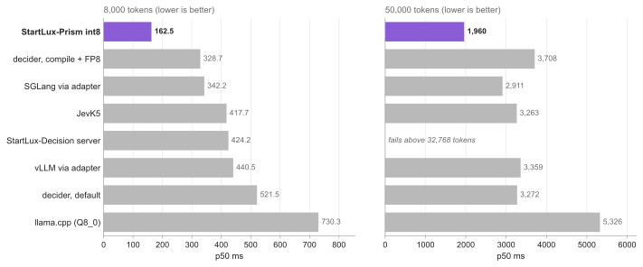
</picture>

`bench/run_long.py` (`scripts/compare.sh` with `BENCH=long`): one yes/no question ("Does the log show a payment that
failed and was never retried successfully?") about a synthetic application log (seeded payment, order, login,
shipping, search and cart events) sized to about 8,000 and 50,000 tokens in StartLux's prompt format, every request
with its own request number. One request at a time (2 warm-up requests, then 20 at 8k and 8 at 50k), and 4 clients for
40 s at 8k. The context limits were raised so that no engine shortens the evidence: llama.cpp `-c 262144 --parallel 4`
(65,536 tokens per slot), vLLM `--max-model-len 65536`, SGLang `--context-length 65536`, decider
`DECIDER_MAX_STATE_TOKENS=65536` (its default, 32,768, cuts the evidence); StartLux-Prism as always (its largest batch,
65,536 tokens, is sized from free GPU memory). The input tokens each engine reports are in the result files: every
engine counted all of them (JevK5 and decider render their own prompts, a few dozen tokens more or fewer).

| engine | 8k: p50 ms | 8k: 4 clients, req/s | 50k: p50 ms | input tokens counted (8k / 50k) |
|---|---|---|---|---|
| **StartLux-Prism int8** | **162.5** | **6.17** | **1,960** | 8,052 / 50,017 |
| StartLux-Prism int8, `--attn-qk8` (opt-in) | 154.6 | 6.47 | 1,658 | 8,052 / 50,017 |
| SGLang 0.5.21 (via adapter) | 342.2 | 2.98 | 2,911 | 8,052 / 50,017 |
| JevK5 0.3.3, stand-in weights | 417.7 | 2.39 | 3,263 | 8,093 / 50,058 |
| decider 1.9.0, default, stand-in weights | 521.5 | 1.56 | 3,272 | 8,020 / 49,985 |
| vLLM 0.31 (via adapter) | 440.5 | 2.63 | 3,359 | 8,052 / 50,017 |
| decider 1.9.0, compile + FP8, stand-in weights | 328.7 | 2.52 | 3,708 | 8,020 / 49,985 |
| StartLux-Decision server | 424.2 | 2.36 | fails (below) | 8,052 / - |
| llama.cpp b10639 + StartLux GGUF server | 730.3 | 1.36 | 5,326 | 8,052 / 50,017 |

StartLux-Prism is 2.0-4.5x faster than the others at 8k and 1.5-2.7x at 50k. At 50k the eight attention layers, quadratic in
the length, take about three quarters of StartLux-Prism's time (164 TFLOP at about 110 TFLOPS on bf16 tensor cores, against
0.35 POP of int8 projections at about 600 TOPS: operation counts and the kernels' measured rates), and every engine runs
attention on bf16 tensor cores, so the int8 projections' advantage covers a smaller share. `--attn-qk8` (q k^T on int8
tensor cores; off by default for its probability error, `docs/optimizations.md`) takes 15% off at 50k.
StartLux-Decision's server fails above 32,768 tokens in every attempt (3): a single prompt longer than its prefill chunk
goes through its chunked path, whose copy of the linear-attention state (`_rows_cache`) expects tensors where
transformers 5.19's cache layers hold dicts (its requirements allow transformers >= 5.8; it was tested on 5.8.1). Its 8k
numbers take the unchunked path.

### Follow-up questions: the prefix cache

<picture>
  <source media="(prefers-color-scheme: dark)" srcset="images/prefix-cache-dark.svg">
  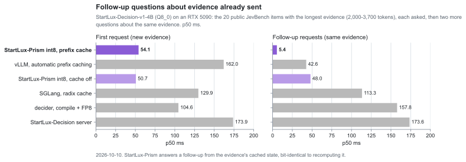
</picture>

The tables above send every request with new evidence, so no engine can reuse anything across requests. A client that
asks a further question about evidence it already sent (or sends one request's questions as separate calls) can be
served from a prefix cache. `bench/run_prefix.py` measures that: sessions of requests about the same evidence, one at a
time on one connection, each session with its own unique evidence (nothing carries over between sessions); 40 timed
sessions per scenario after 5 warm-up ones. Scenarios: **ticket** (startlux3's ticket, its three questions as three
requests in turn; 230 evidence tokens), **longpage** (longpage2's page, its two questions as two requests; 935),
**jevbench** (the 20 public JevBench items with the longest evidence, 2,000-3,700 tokens: the item's question, then a
yes/no and a 4-level score about the same evidence). p50 ms, first request / follow-ups:

| engine (cache across requests) | ticket | longpage | jevbench |
|---|---|---|---|
| **StartLux-Prism int8** (prefix cache, default; 2026-10-10) | 9.5 / **4.6** | 25.6 / **4.7** | 54.1 / **5.4** |
| StartLux-Prism int8, `--prefix-cache 0` | 9.6 / 9.3 | 25.6 / 19.1 | 50.7 / 48.0 |
| SGLang 0.5.21 via adapter (radix cache) | 29.0 / 17.7 | 69.8 / 55.9 | 129.9 / 113.3 |
| vLLM 0.31 via adapter (automatic prefix caching) | 34.6 / 33.8 | 86.0 / 75.4 | 162.0 / 42.6 |
| decider 1.9.0 compile + FP8, stand-in weights (none across requests) | 16.3 / 41.0 | 44.5 / 33.6 | 104.6 / 157.8 |
| StartLux-Decision server (system text only) | 24.4 / 24.4 | 79.6 / 58.2 | 173.9 / 173.6 |

(Follow-ups without a cache differ from first requests only by their questions' length; decider's follow-ups, a yes/no
and a 4-level score, were slower than its first requests in every scenario - not investigated.) StartLux-Prism answers a
follow-up in about the time of a request with no evidence at all: 2x faster than recomputing on the ticket, 4x on the
page, 8.7x on long evidence, and 8-20x faster than SGLang's and vLLM's follow-ups. Its hits are bit-identical to
recomputing the evidence.

Cost on requests that never reuse their evidence: measured in one process, two engines (cache on, every request a miss;
cache off), requests interleaved so clock changes hit both alike (`bench/cache_cost.py`, 100 pairs): startlux3 +0.03 ms
(+0.35%), startlux1 +0.07 ms (+0.8%), longpage2 +0.03 ms (+0.1%), the longest JevBench item 0.00 ms, a 480-token JevBench
item +0.13 ms (+1.3%); readme3, yesno and review1 (evidence under 64 tokens, not cached) 0. The first-request column
above differs more between the two StartLux-Prism rows (54.1 against 50.7 ms; 55.2 in the cache-on run measured next to the
cache-off one on 2026-10-09) because the runs held different clocks: that cache-on run alternated long and short
requests and averaged 2.31 GHz, the cache-off run 2.61 GHz (NVML, recorded in `results/prefix/`). The standard suites
(the first table) run with the cache on, within 2% of cache-off runs, 205/231.

Memory: 64 entries x (48 MiB of linear-attention state + 2.4 MB of conv tails) and 65,536 KV rows x 32 KiB: 5.1 GiB
with the defaults (`--prefix-cache 64 --prefix-cache-tokens 65536`; the server took 13,200 MiB instead of 7,930 MiB).
With long evidence the KV rows run out first (23 entries of about 2,750 tokens in the jevbench scenario).

## StartLux-Decision-v1-9B on an RTX 5090

<picture>
  <source media="(prefers-color-scheme: dark)" srcset="images/rtx5090-9b-dark.svg">
  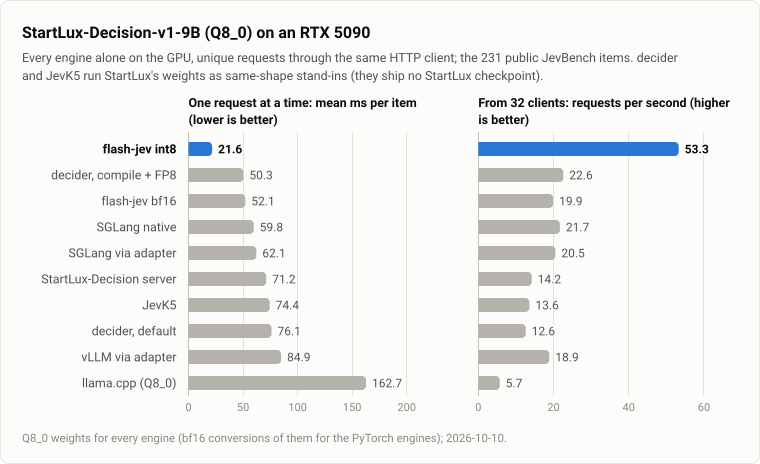
</picture>

The same procedure on StartLux-Decision-v1-9B's Q8_0 GGUF (`StartLux-Decision-9B-Q8_0.gguf`, 9.53 GB, SHA-256
`9daae505…`; hidden 4096, feed-forward 12288, untied output head; the same
linear-attention and attention heads as the 4B), on 2026-10-10 between 17:53 and 20:03: `scripts/new_model.sh` first
(the dispatch table entries for its projection shapes, its int8 calibration, and the correctness tests: int8 and bf16
make the fp32 reference's decision on 23/23 questions, largest probability difference 0.043 and 0.003; the CUDA GEMM
gives the Triton kernel's bits on all 297 configs; prefix-cache hits are bit-identical), then `scripts/stress.sh` with
the environment `scripts/prepare_model.sh` printed. Settings changed for 17.9 GB of bf16 weights: SGLang
`--max-mamba-cache-size 96` (19 running requests; 160 does not fit), decider `DECIDER_GRAPH_TOKEN_BUDGET=16384` (its
default, 32,768, runs out of memory in its warm-up). StartLux-Prism's largest batch is 49,152 tokens with its prefix cache
and 65,536 without (the long-evidence runs). decider and JevK5 have no 9B checkpoints: stand-in weights only (speed;
scores in parentheses). The model card gives 200/231 for this file.

| engine | startlux3 | startlux1 | readme3 | yesno | longpage2 | wide33 | review1 | max req/s (c) | JevBench | JevBench mean / p50 / p95 |
|---|---|---|---|---|---|---|---|---|---|---|
| **StartLux-Prism int8** (W8A8) | **15.50** | **14.27** | **10.75** | **7.71** | **36.50** | **17.87** | **7.80** | **182 (64)** | 200/231 | **21.6 / 8.0 / 76** |
| StartLux-Prism bf16 | 29.84 | 24.29 | 17.22 | 13.54 | 89.29 | 33.51 | 13.19 | 68 (64) | 201/231 | 52.1 / 12.8 / 210 |
| decider 1.9.0, compile + FP8, stand-in weights | 111.56 | 25.75 | 56.25 | 16.52 | 137.51 | 24.98 | 56.07 | 25 (16) | (202) | 50.3 / 23.8 / 164 |
| SGLang 0.5.21 native `/v1/systemone` (bf16) | 73.98 | 35.84 | 37.49 | 25.24 | 185.24 | 45.08 | 25.71 | 45 (64) | 199/231 | 59.8 / 22.3 / 214 |
| SGLang 0.5.21 (bf16, via adapter) | 81.50 | 34.92 | 46.22 | 22.20 | 185.09 | 57.06 | 26.30 | 39 (64) | 201/231 | 62.1 / 26.4 / 212 |
| StartLux-Decision server (bf16) | 89.56 | 33.58 | 39.96 | 18.89 | 212.00 | 51.47 | 18.98 | 29 (4) | 201/231 | 71.2 / 24.4 / 261 |
| JevK5 0.3.3 (bf16), stand-in weights | 123.53 | 36.79 | 60.76 | 23.97 | 247.23 | 126.74 | 24.21 | 20 (4) | (199) | 74.4 / 28.4 / 260 |
| decider 1.9.0, default (bf16), stand-in weights | 200.75 | 36.87 | 96.88 | 22.38 | 153.88 | 36.12 | 96.73 | 13 (4) | (202) | 76.1 / 33.7 / 280 |
| vLLM 0.31 (bf16, via adapter) | 111.01 | 46.89 | 64.38 | 30.94 | 231.14 | 88.52 | 29.86 | 36 (16) | 201/231 | 84.9 / 38.6 / 271 |
| llama.cpp b10639 (Q8_0) + StartLux GGUF server | 346.41 | 100.68 | 283.79 | 88.02 | 445.30 | 271.93 | 87.11 | 6 (16) | 200/231 | 162.7 / 95.7 / 399 |

StartLux-Prism int8 against the best other engine on each: startlux3 4.8x (74.0 ms, SGLang native), startlux1 1.8x (25.8,
decider compile+FP8), readme3 3.5x, yesno 2.1x, longpage2 3.8x, wide33 1.4x, review1 2.4x, throughput 4.0x (45, SGLang
native), JevBench mean 2.3x (50.3, decider compile+FP8), p50 2.8x, p95 2.2x: further ahead than on the 4B, the larger
projections being more of the work. Every engine that renders StartLux's prompts scores 200 or 201.

Many clients at once (requests/s, p50 ms; no engine failed a request) and long evidence (the 4B's settings; StartLux-Prism
`--prefix-cache 0`):

| engine | JevBench, 8 / 16 / 32 clients | 8k tokens, 8 / 16 / 32 clients | 8k: one at a time, 4 clients | 50k: one at a time |
|---|---|---|---|---|
| **StartLux-Prism int8** | **53.2 (147) / 53.2 (298) / 53.3 (587)** | **4.07 / 4.02 / 4.01** | **244 ms, 4.05 req/s** | **2,582 ms** |
| decider 1.9.0, compile + FP8, stand-in | 24.1 / 23.8 / 22.6 | 2.25 / 2.24 / 2.23 | 458 ms, 2.23 req/s | 4,925 ms |
| SGLang 0.5.21 native | 20.8 / 21.4 / 21.7 | - | - | - |
| SGLang 0.5.21 (via adapter) | 19.9 / 20.4 / 20.5 | 1.69 / 1.68 / 1.67 | 603 ms, 1.68 req/s | 4,515 ms |
| StartLux-Prism bf16 | 19.9 / 20.0 / 19.9 | - | - | - |
| vLLM 0.31 (via adapter) | 18.7 / 18.9 / 18.9 | 1.54 / 1.53 / 1.52 | 702 ms, 1.53 req/s | 5,039 ms |
| StartLux-Decision server | 14.3 / 14.2 / 14.2 | 1.43 / 1.42 / 1.42 | 699 ms, 1.42 req/s | fails (as on the 4B) |
| JevK5 0.3.3, stand-in | 13.7 / 13.6 / 13.6 | 1.45 / 1.43 / 1.43 | 690 ms, 1.44 req/s | 5,031 ms |
| decider 1.9.0, default, stand-in | 13.7 / 13.2 / 12.6 | 1.24 / 1.24 / 1.24 | 799 ms, 1.25 req/s | out of memory (HTTP 500) |
| llama.cpp b10639 | 6.4 / 5.8 / 5.7 | 1.10 / 1.07 / 1.08 | 926 ms, 1.09 req/s | 6,406 ms |

decider's default mode runs out of GPU memory on the 50k request (`torch.OutOfMemoryError` in flash-linear-attention's
`chunk_fwd_o`, reproduced once more alone): 17.9 GB of bf16 weights, its CUDA graphs and 50k tokens of activations do
not fit; with FP8 weights it does.

## StartLux-Decision-v1-27B on an H200

<picture>
  <source media="(prefers-color-scheme: dark)" srcset="images/h200-27b-dark.svg">
  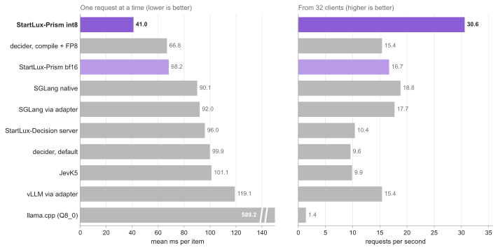
</picture>

StartLux-Decision-v1-27B from its Q8_0 GGUF (`StartLux-Decision-27B-Q8_0.gguf`, 28.60 GB, SHA-256 `5868a8a2…`; the
Q4_K_M rows: `StartLux-Decision-27B-Q4_K_M.gguf`; hidden 5120, 64 layers: 48 linear-attention with 48 value heads, 16
attention with 24 heads over 4 KV heads;
untied output head) on the H200 ([Setup](#setup)), with `scripts/stress.sh` steps 0-3 and 5 and `env-27b.sh` for the
folders; the converted bf16 checkpoint and its views as for the 9B (`scripts/prepare_model.sh`). SGLang's JIT kernels
needed the CUDA folder's `lib64 -> lib` link, as on the RTX 5090 server. decider and JevK5 have no 27B checkpoints:
stand-in weights only (speed; scores in parentheses).

StartLux-Prism on Hopper (`docs/optimizations.md`, "H200"): its int8 GEMMs on warpgroup-MMA kernels with TMA and warp
specialization (`csrc/w8a8_wgmma.cu`; 1,240-1,420 TOPS at 4,000-8,000 tokens) and a dispatch table measured on the
H200 (`kernels/gemm_table_h200.json`), wider attention and linear-attention tiles than on the RTX 5090, int64 offsets
for its 131,072-token batches; int8 calibration computed on the H200. Correctness there: int8 and bf16 make the fp32
reference's decision on 23/23 questions (largest probability difference 0.034 and 0.005), every GEMM config gives the
Triton kernel's bits (915 configs), prefix-cache hits are bit-identical to misses, and `tests/test_stress.py` passes
11/11 ([Stress tests](#stress-tests)). Its largest batch here is 131,072 tokens, with the prefix cache on.

| engine (27B Q8_0, H200) | startlux3 | startlux1 | readme3 | yesno | longpage2 | wide33 | review1 | max req/s (c) | JevBench | JevBench mean / p50 / p95 |
|---|---|---|---|---|---|---|---|---|---|---|
| **StartLux-Prism int8** (W8A8) | **25.01** | **22.78** | **16.98** | **13.38** | **71.57** | **31.37** | **13.63** | **100 (64)** | 207/231 | **41.0 / 14.2 / 146** |
| decider 1.9.0, compile + FP8, stand-in weights | 158.57 | 33.16 | 66.42 | 20.18 | 291.16 | 32.97 | 66.01 | 17 (64) | (206) | 66.8 / 26.2 / 222 |
| StartLux-Prism bf16 | 38.60 | 37.11 | 23.86 | 18.82 | 116.14 | 44.76 | 18.69 | 56 (64) | 209/231 | 68.2 / 19.4 / 267 |
| SGLang 0.5.21 native `/v1/systemone` (bf16) | 97.93 | 57.37 | 60.62 | 57.11 | 200.17 | 70.97 | 57.36 | 38 (64) | 211/231 | 90.1 / 57.7 / 244 |
| SGLang 0.5.21 (bf16, via adapter) | 95.48 | 59.59 | 60.59 | 57.93 | 201.47 | 117.84 | 57.95 | 32 (64) | 209/231 | 92.0 / 58.8 / 247 |
| StartLux-Decision server (bf16) | 108.23 | 52.20 | 50.61 | 29.92 | 296.70 | 77.80 | 30.19 | 19 (64) | 209/231 | 96.0 / 37.3 / 339 |
| decider 1.9.0, default (bf16), stand-in weights | 271.83 | 51.70 | 108.48 | 29.04 | 219.33 | 51.41 | 109.27 | 10 (16) | (208) | 99.9 / 37.8 / 352 |
| JevK5 0.3.3 (bf16), stand-in weights | 149.94 | 51.62 | 109.08 | 38.31 | 332.31 | 161.58 | 38.47 | 13 (4) | (211) | 101.1 / 39.6 / 341 |
| vLLM 0.31 (bf16, via adapter) | 175.80 | 74.94 | 136.97 | 69.49 | 207.16 | 205.92 | 71.88 | 27 (64) | 209/231 | 119.1 / 72.3 / 305 |
| llama.cpp b10639 (Q8_0) + StartLux GGUF server | 1308.49 | 363.70 | 1095.01 | 320.32 | 1675.92 | 1018.82 | 327.33 | 2 (16) | 209/231 | 589.2 / 359.6 / 1431 |

StartLux-Prism int8 against the best other engine on each: startlux3 3.8x (95.5 ms, SGLang), startlux1 1.5x (33.2, decider
compile+FP8), readme3 3.0x (50.6, StartLux's server), yesno 1.5x (20.2), longpage2 2.8x (200.2, SGLang native), wide33
1.05x (33.0, decider compile+FP8, which renders a shorter prompt), review1 2.2x (30.2), throughput 2.6x (38, SGLang
native), JevBench mean 1.6x (66.8, decider compile+FP8), p50 1.8x, p95 1.5x. Its 207/231 is two hard items below the
bf16 engines' 209 (the model card's): W8A8 on this model moves two near-ties; StartLux-Prism bf16 scores 209.

<picture>
  <source media="(prefers-color-scheme: dark)" srcset="images/h200-27b-long-dark.svg">
  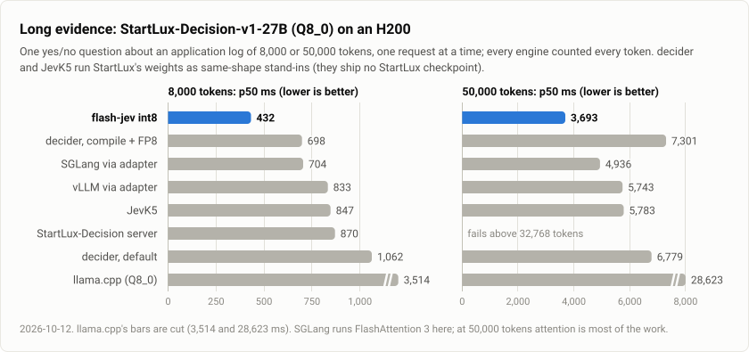
</picture>

Many clients at once (requests/s, p50 ms; no engine failed a request) and long evidence (every engine with the 4B's
long-context settings; StartLux-Prism with its prefix cache):

| engine | JevBench, 8 / 16 / 32 clients | 8k tokens, 8 / 16 / 32 clients | 8k: one at a time, 4 clients | 50k: one at a time |
|---|---|---|---|---|
| **StartLux-Prism int8** | **29.1 (257) / 29.8 (545) / 30.6 (968)** | **2.33 / 2.34 / 2.33** | **432 ms, 2.32 req/s** | **3,693 ms** |
| SGLang 0.5.21 native | 16.3 / 18.0 / 18.8 | - | - | - |
| SGLang 0.5.21 (via adapter) | 15.8 / 17.2 / 17.7 | 1.35 / 1.47 / 1.47 | 704 ms, 1.37 req/s | 4,936 ms |
| StartLux-Prism bf16 | 16.1 / 16.3 / 16.7 | - | - | - |
| decider 1.9.0, compile + FP8, stand-in | 15.9 / 16.0 / 15.4 | 1.35 / 1.42 / 1.43 | 698 ms, 1.18 req/s | 7,301 ms |
| vLLM 0.31 (via adapter) | 14.2 / 15.1 / 15.4 | 1.26 / 1.26 / 1.26 | 833 ms, 1.26 req/s | 5,743 ms |
| StartLux-Decision server | 10.4 / 10.4 / 10.4 | 1.15 / 1.14 / 1.14 | 870 ms, 1.15 req/s | fails (as on the 4B) |
| decider 1.9.0, default, stand-in | 10.2 / 10.2 / 9.6 | 0.88 / 0.92 / 0.95 | 1,062 ms, 0.78 req/s | 6,779 ms |
| JevK5 0.3.3, stand-in | 9.9 / 9.9 / 9.9 | 1.18 / 1.17 / 1.17 | 847 ms, 1.17 req/s | 5,783 ms |
| llama.cpp b10639 | 1.4 / 1.4 / 1.4 | 0.29 / 0.28 / 0.28 | 3,514 ms, 0.29 req/s | 28,623 ms |

JevBench from 32 clients: 1.6x the next best (SGLang native); 8k-token requests from 32 clients: 1.6x (SGLang); one
8k request 1.6x faster than the next (decider compile+FP8, SGLang), a 50k one 1.3x (SGLang, with FlashAttention 3:
attention is most of a 50k pass). With the RTX 5090's attention tiles (a first StartLux-Prism run the same day; its files
in `results/h200_attn32/`) the 50k request took 5,642 ms, behind SGLang, and 8k 482 ms; JevBench and the other suites
within 1-3% of the table's.

**The Q4_K_M file on the H200** (16.55 GB): StartLux-Prism on its own 4-bit weights (W4A8), and requantized at start-up to
the int8 path's per-row W8A8 (`--precision int8` on the same file); llama.cpp on the file:

| engine (27B Q4_K_M, H200) | startlux3 | yesno | longpage2 | max req/s (c) | JevBench | JevBench mean / p50 / p95 | JevBench, 8 / 16 / 32 clients | 8k: alone, 8-32 clients | 50k alone |
|---|---|---|---|---|---|---|---|---|---|
| **StartLux-Prism W4A8** | **91.49** | **42.58** | **270.93** | **25 (64)** | 207/231 | **155.2 / 43.8 / 571** | **7.2 / 7.4 / 7.5** | **1,711 ms, 0.59 req/s** | **11,446 ms** |
| StartLux-Prism, requantized to per-row W8A8 | 25.11 | 13.40 | 71.65 | 100 (64) | 207/231 | 41.1 / 14.0 / 147 | - | - | - |
| llama.cpp b10639 | 1381.20 | 330.66 | 1811.97 | 2 (4) | 207/231 | 626.7 / 374.2 / 1564 | 1.4 / 1.4 / 1.3 | 3,946 ms, 0.25 req/s | 29,941 ms |

W4A8 against llama.cpp on the same file: JevBench mean 4.0x, p50 8.5x, 5.0-5.6x its rate from 8-32 clients, 8k and 50k
tokens 2.3x and 2.6x; every engine scores 207/231 here (the model card: 208). On the H200 W4A8 still runs its GEMMs on
mma.sync (200-300 TOPS against the int8 path's 1,250 on wgmma: `docs/optimizations.md`, Open), so the file's own
4-bit weights are 3.8x slower than requantizing them, which matches the Q8_0 file's int8 speed and score.

## Q4_K_M files: W4A8

<picture>
  <source media="(prefers-color-scheme: dark)" srcset="images/q4km-dark.svg">
  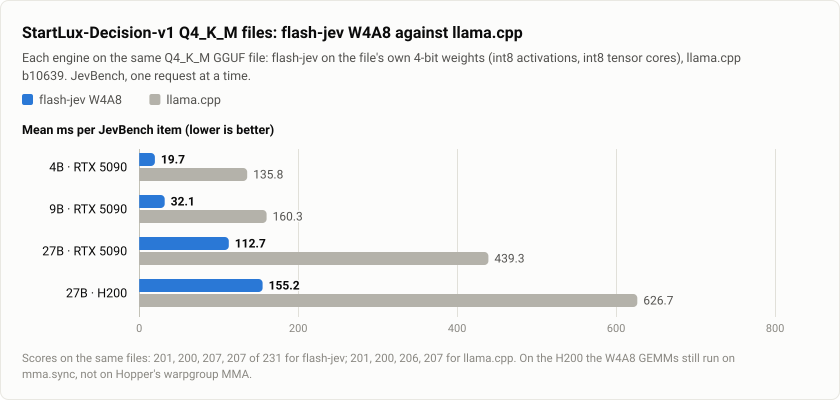
</picture>

StartLux-Decision-v1's Q4_K_M GGUFs (`StartLux-Decision-4B-Q4_K_M.gguf` 2.71 GB, `-9B-Q4_K_M.gguf` 5.63 GB,
`-27B-Q4_K_M.gguf` 16.55 GB; Q4_K with Q6_K for some tensors) run on
StartLux-Prism's W4A8 path (`--precision auto` picks it for a k-quant file): the file's Q4_K / Q6_K values as they are, int8
activations with one scale per 256 inputs, int8 tensor cores (`startlux_prism/kernels/w4a8.py`, `csrc/w4a8_gemm.cu`; how and
why: `docs/optimizations.md`). Requantizing the 4-bit weights to the int8 path's per-row W8A8 instead (the first way
tried) gave the 4B 198/231: a second quantization on top of the 4-bit one. llama.cpp runs the same file (`-c 16384
--parallel 4`, its model card's settings). p50 ms at concurrency 1, as the first table; RTX 5090, 2026-10-11:

| engine (on the Q4_K_M file) | startlux3 | startlux1 | readme3 | yesno | longpage2 | wide33 | review1 | max req/s (c) | JevBench | JevBench mean / p50 / p95 |
|---|---|---|---|---|---|---|---|---|---|---|
| **4B: StartLux-Prism W4A8** | **14.15** | **12.01** | **8.75** | **5.88** | **33.53** | **15.57** | **6.19** | **198 (64)** | **201/231** | **19.7 / 6.6 / 72** |
| 4B: StartLux-Prism bf16 (dequantized) | 18.94 | 16.14 | 11.55 | 9.01 | 50.39 | 20.48 | 8.88 | 126 (64) | 202/231 | 29.6 / 8.8 / 115 |
| 4B: StartLux-Prism, requantized to per-row W8A8 | 10.09 | 9.42 | 6.51 | 5.19 | 24.24 | 12.12 | 5.30 | 295 (64) | 198/231 | 15.4 / 5.5 / 54 |
| 4B: llama.cpp b10639 | 315.20 | 89.56 | 267.24 | 83.96 | 379.43 | 256.08 | 82.10 | 7 (4) | 201/231 | 135.8 / 89.3 / 322 |
| 4B: SGLang 0.5.21 GGUF (its dp4a kernels) | 329.05 | 129.02 | 141.18 | 57.70 | 786.97 | 186.52 | 63.23 | 9 (64) | 200/231 | 249.8 / 73.8 / 959 |
| **9B: StartLux-Prism W4A8** | **21.48** | **16.52** | **13.29** | **10.57** | **56.53** | **22.29** | **10.25** | **117 (64)** | **200/231** | **32.1 / 10.0 / 117** |
| 9B: StartLux-Prism, requantized to per-row W8A8 | 15.50 | 14.36 | 10.75 | 7.69 | 36.48 | 17.71 | 7.68 | 183 (64) | 201/231 | 21.7 / 7.9 / 76 |
| 9B: llama.cpp b10639 | 345.94 | 100.67 | 283.17 | 86.07 | 453.34 | 270.71 | 86.46 | 6 (4) | 200/231 | 160.3 / 94.1 / 403 |
| **27B: StartLux-Prism W4A8** | **67.36** | **61.59** | **42.52** | **28.91** | **202.00** | **74.97** | **29.40** | **32 (64)** | **207/231** | **112.7 / 34.8 / 418** |
| 27B: llama.cpp b10639 | 970.57 | 282.29 | 789.26 | 241.74 | 1249.94 | 763.35 | 246.71 | 2 (4) | 206/231 | 439.3 / 270.2 / 1091 |

The model cards give 201/231 for the 4B and 9B files (llama.cpp) and 208 for the 27B's. W4A8 scores 201, 200 and 207
(the 4B and 9B 203 and 201 before its floating-point step was fused into FMAs: two and one borderline hard items
moved), against the fp32 reference of the same file 23/23 and 22/23 decisions on the 4B and 9B (largest probability
difference 0.031 and 0.032; `tests/test_engine.py`); prefix-cache hits and mixed batches are bit-identical to misses,
as on the int8 path (`tests/test_prefix_cache.py --exact`). It is 6.9x (4B), 5.0x (9B) and 3.9x (27B) faster than
llama.cpp on JevBench, and takes 1.3x (4B) and 1.5x (9B) the int8 path's mean latency: its Q4_K GEMMs still carry four
scale multiply-adds per MMA and a floating-point step per 256 inputs that W8A8 has not, and Q6_K's two multiply-adds per
output and step keep those tensors at 2.2-2.6x W8A8's time (`docs/optimizations.md`). The kernel's second pass
(2026-10-11: scales stored super-block-major, larger warp tiles, the mins and the floating-point step on fewer
instructions, a tuning table per shape) took the 4B from 22.1 to 19.7 ms mean (p50 8.2 to 6.6) and the 9B from 36.6 to
32.1 (11.7 to 10.0).

Memory: the 9B takes 65,536-token batches with the prefix cache on (int8: 49,152), the 4B 22.3 GiB; that is what makes
the 27B fit the RTX 5090: its Q4_K_M file on W4A8 runs with a smaller prefix cache (`--prefix-cache 8`: a cache entry
holds 151 MB of recurrent state on the 27B, 48 MiB on the 4B; largest batch then 6,144 tokens). The 27B became possible
once its value-head count stopped being assumed a power of two (three Triton kernels pad it and mask; the 4B's and 9B's
answers bit-identical before and after). Every engine on the 27B, Q8_0 and Q4_K_M:
[the H200 section](#startlux-decision-v1-27b-on-an-h200).

**Under stress** (`scripts/stress.sh` steps 1-5 on the 4B and 9B Q4_K_M files, 2026-10-11:
`ENGINES="startlux-prism-w4a8 llamacpp"`, `STRESS_PREC=w4a8 STARTLUX_PRISM_PREC=w4a8 MAXCTX_ENGINES=StartLux-Prism`; requests/s, p50 ms in
brackets):

| on the Q4_K_M file | JevBench c=8 | c=16 | c=32 | score per pass (c=32) | 8k c=8 | c=16 | c=32 | 8k alone p50 | 50k alone p50 |
|---|---|---|---|---|---|---|---|---|---|
| **4B: StartLux-Prism W4A8** | **59.0 (134)** | **59.1 (269)** | **58.4 (530)** | 201/202/202 | **4.34 (1845)** | **4.29 (3728)** | **4.27 (7485)** | **231** | **2,322** |
| 4B: llama.cpp b10639 | 6.6 (1160) | 6.6 (2395) | 6.5 (4800) | 199/200/199 | 1.35 (4412) | 1.33 (10384) | 1.33 (21910) | 746 | 5,493 |
| **9B: StartLux-Prism W4A8** | **34.5 (221)** | **34.7 (465)** | **34.6 (936)** | 200/200/200 | **2.70 (2960)** | **2.67 (5989)** | **2.66 (12019)** | **369** | **3,209** |
| 9B: llama.cpp b10639 | 6.2 (1209) | 6.3 (2519) | 6.3 (5043) | 199/199/199 | 1.07 (5586) | 1.05 (13177) | 1.05 (27662) | 948 | 6,536 |

W4A8 serves JevBench at 9x (4B) and 5.5x (9B) llama.cpp's rate and 8k-token requests at 3.2x and 2.5x; every token of
the 50k requests counted by both. One pass without chunking: the 4B answers 64,000 tokens (3.3 s) with its prefix
cache and 96,000 (6.2 s) without, the 9B 64,000 (4.4 s) either way (its largest batch, 65,536 tokens). The 9B's first
`tests/test_stress.py` launch died in a segfault at start (this machine; rerun: passed).

**SGLang on the same file.** SGLang 0.5.21 has a GGUF loader with llama.cpp-derived kernels (MMVQ up to 2-6 tokens,
MMQ beyond), but it does not load these files: with the repositories' config.json (the multimodal
Qwen3_5ForConditionalGeneration) it sends the .gguf to an image processor; with the text-only config beside it, it has
no GGUF tensor-name map for Qwen3.5 (`Unknown gguf model_type: qwen3_5_text`); and a map alone would still load
llama.cpp's converted tensors as they are (norms + 1, -exp(A_log), the linear-attention value heads in tiled order),
could not load in_proj_qkv as three shards of a GGUF parameter, and would drop the 9B's untied output head.
`bench/adapters/sglang_gguf.py` supplies these at load time without changing SGLang (llama.cpp's conversion undone as in
`startlux_prism/tools/gguf_to_hf.py`; the quantized tensors' rows reordered, never requantized; ssm_out's input permuted
instead of its columns), and `scripts/compare.sh sglang-gguf` runs it with the `sglang` flags. On the 4B it scores
200/231, which checks the loading, and is 6.2x slower than SGLang on the bf16 checkpoint (JevBench mean 249.8 ms against
40.1) and 12.7x slower than W4A8: its Q4_K and Q6_K MMQ kernels have no tensor-core instructions on sm_120 (64 dp4a per
tile step, CUDA-core int8 dot products; `cuobjdump -sass` of sgl_kernel), and it runs each fused projection shard by
shard. The 9B did not start: its launches died at random ([Crashes](#crashes-on-the-rtx-5090-server)).

## The longest request in one pass

<picture>
  <source media="(prefers-color-scheme: dark)" srcset="images/max-context-dark.svg">
  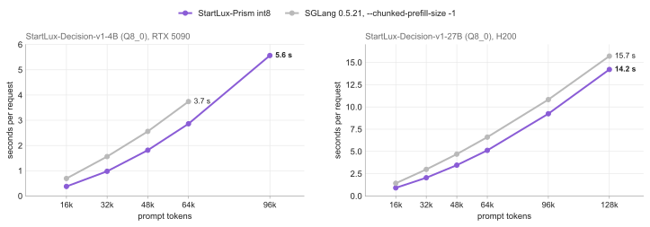
</picture>

`scripts/max_context.sh`: one request at a time at 16k, 32k, 48k, 64k, 96k, 128k, 192k and 256k tokens until one
fails, each engine computing the whole prompt in one forward pass (p50 ms of one request after one warm-up).

**StartLux-Decision-v1-4B (`StartLux-Decision-4B-Q8_0.gguf`) on the RTX 5090:**

| engine | 16k | 32k | 48k | 64k | 96k | longest |
|---|---|---|---|---|---|---|
| StartLux-Prism int8 (default: prefix cache on) | 379 | 980 | 1,812 | 2,870 | refused (HTTP 422) | 65,536 tokens (its largest batch) |
| StartLux-Prism int8, `--prefix-cache 0` | 377 | 978 | 1,814 | 2,861 | 5,567 | 98,304 tokens |
| SGLang 0.5.21, `--chunked-prefill-size -1` | - | - | - | - | - | does not start (below) |
| SGLang, the same with `--mem-fraction-static 0.6 --max-mamba-cache-size 16` | 692 | 1,562 | 2,559 | 3,741 | out of memory | between 64k and 96k |
| vLLM 0.31, `--no-enable-chunked-prefill` | - | - | - | - | - | does not start (below) |

SGLang without chunking sizes its memory for one pass over its whole context (262,144 tokens here), which leaves its
KV cache nothing ("raise --mem-fraction-static above 0.264"); with the static fraction lowered by hand it reaches 64k.
vLLM refuses this model without chunked prefill ("Chunked prefill is required for mamba cache mode 'align'"). With their
default chunked prefill both reach the model's 262,144 tokens: one 256,000-token request took 33.9 s on SGLang and
38.2 s on vLLM. StartLux-Prism computes a request in one pass by design (a CUDA graph per batch size); its largest batch
comes from GPU memory (README, Serving), and a longer request is refused, never cut.

**StartLux-Decision-v1-27B (`StartLux-Decision-27B-Q8_0.gguf`, W4A8: `-Q4_K_M.gguf`) on the H200:**

| engine (27B Q8_0, H200) | 16k | 32k | 48k | 64k | 96k | 128k | longest |
|---|---|---|---|---|---|---|---|
| **StartLux-Prism int8** (prefix cache on; off: within 1%) | **910** | **2,047** | **3,460** | **5,120** | **9,234** | **14,205** | 131,072 tokens (its largest batch) |
| SGLang 0.5.21, `--chunked-prefill-size -1` | 1,424 | 2,984 | 4,697 | 6,605 | 10,821 | 15,705 | between 128k and 192k (out of memory) |
| SGLang, the same with `--mem-fraction-static 0.6 --max-mamba-cache-size 16` | 1,427 | 2,990 | 4,714 | 6,604 | 10,835 | 15,682 | between 128k and 192k |
| vLLM 0.31, `--no-enable-chunked-prefill` | - | - | - | - | - | - | does not start (as on the 4B) |
| StartLux-Prism W4A8 (Q4_K_M) | 3,422 | 7,054 | 10,924 | 15,045 | 24,069 | 34,054 | 131,072 tokens |

StartLux-Prism int8 is 1.56x SGLang at 16k and 1.11x at 128k (attention, quadratic in the length, takes over; SGLang's is
FlashAttention 3). With the RTX 5090's attention tiles it took 29.2 s at 128k. With their default chunked prefill
SGLang and vLLM answer a 256,000-token request in 41.7 s and 45.9 s; StartLux-Prism refuses anything beyond its largest
batch (HTTP 422), never cuts it.

## Accuracy: StartLux-Decision-v1's evaluation

Does StartLux-Prism's speed cost accuracy? StartLux-Decision-v1's own evaluation, unchanged (`eval/suites.py` of
[StartLuxLabs/StartLux-Decision-v1](https://github.com/StartLuxLabs/StartLux-Decision-v1), byte-identical to its main
branch on 2026-10-13): the seven accuracy suites of the Intern-Decision bundle (InternLM/Intern-Decision @ 2f81580: the
three public JevBench tiers, Typed Decisions test, ToolACE test, AG News test and WildJailBreak test; 10,751 rows,
12,351 decisions), scored with the upstream JevBench code at 7ce310c7 (accuracy per suite, their unweighted average,
Brier and ECE on JevBench hard), and the bundle's calibration pilot (96 questions whose answer is a known probability
distribution; its own scorer, expected Brier and ECE). Every engine through its `/v1/systemone`, one request at a time
(`suites.py predict --endpoint`), on the RTX 5090, 2026-10-13. The reference is StartLux-Decision's own server
(`startlux_decision.server`, the implementation the published numbers come from) on the same GPU, the same weights
(bf16, converted from the same Q8_0 file) and the same client. It reproduces StartLux's published averages: 91.15 for the
4B (published 91.17; StartLux's own rerun gives 91.15) and 91.06 for the 9B (91.08). StartLux-Prism int8 also ran from 8
clients at once.

### StartLux-Decision-v1-4B (RTX 5090)

| engine | Easy | Original | Hard | Typed | ToolACE | AG News | WildJB | Average | JevBench public | Brier (Hard) | ECE (Hard) | pilot Brier | pilot ECE |
|---|---|---|---|---|---|---|---|---|---|---|---|---|---|
| StartLux-Decision server (reference) | 100.00 | 100.00 | 75.68 | 79.95 | 94.19 | 90.83 | 97.38 | **91.15** | 204 | 0.3747 | 0.1074 | 0.4991 | 0.0584 |
| StartLux-Prism int8 | 100.00 | 100.00 | 76.58 | 79.30 | 94.19 | 90.74 | 97.19 | **91.14** | 205 | 0.3740 | 0.1153 | 0.4998 | 0.0615 |
| StartLux-Prism int8, 8 clients at once | 100.00 | 100.00 | 76.58 | 79.30 | 94.19 | 90.74 | 97.19 | **91.14** | 205 | 0.3740 | 0.1153 | 0.4998 | 0.0615 |
| StartLux-Prism bf16 | 100.00 | 100.00 | 76.58 | 79.80 | 94.19 | 90.82 | 97.42 | **91.26** | 205 | 0.3755 | 0.1034 | 0.4994 | 0.0585 |
| StartLux-Prism W4A8 (Q4_K_M file) | 100.00 | 100.00 | 72.97 | 78.90 | 93.55 | 90.95 | 96.88 | **90.46** | 201 | 0.3712 | 0.1024 | 0.4930 | 0.0568 |
| StartLux-Decision-v1-4B, published (original weights) | 100.00 | 100.00 | 75.68 | 79.95 | 94.19 | 90.91 | 97.47 | 91.17 | | | | | |

| engine, against | decisions | same decision | right → wrong | wrong → right | mean / max abs. probability difference | bit-identical |
|---|---|---|---|---|---|---|
| StartLux-Prism int8, against StartLux-Decision server (reference) | 12,351 | 12,223 (98.96%) | 70 | 47 | 0.0055 / 0.235 | 0 |
| StartLux-Prism int8, 8 clients at once, against StartLux-Decision server (reference) | 12,351 | 12,223 (98.96%) | 70 | 47 | 0.0055 / 0.235 | 0 |
| StartLux-Prism bf16, against StartLux-Decision server (reference) | 12,351 | 12,330 (99.83%) | 11 | 9 | 0.0008 / 0.026 | 0 |
| StartLux-Prism W4A8 (Q4_K_M file), against StartLux-Decision server (reference) | 12,351 | 12,111 (98.06%) | 127 | 99 | 0.0098 / 0.423 | 0 |
| StartLux-Prism int8, 8 clients at once, against StartLux-Prism int8 | 12,351 | 12,351 (100.00%) | 0 | 0 | 0.0000 / 0.000 | 12,351 |

### StartLux-Decision-v1-9B (RTX 5090)

| engine | Easy | Original | Hard | Typed | ToolACE | AG News | WildJB | Average | JevBench public | Brier (Hard) | ECE (Hard) | pilot Brier | pilot ECE |
|---|---|---|---|---|---|---|---|---|---|---|---|---|---|
| StartLux-Decision server (reference) | 100.00 | 97.22 | 74.77 | 81.35 | 94.84 | 91.99 | 97.24 | **91.06** | 201 | 0.3563 | 0.0785 | 0.4774 | 0.0376 |
| StartLux-Prism int8 | 100.00 | 95.83 | 74.77 | 81.35 | 94.52 | 91.91 | 97.19 | **90.80** | 200 | 0.3555 | 0.0905 | 0.4762 | 0.0299 |
| StartLux-Prism bf16 | 100.00 | 97.22 | 74.77 | 81.30 | 94.84 | 92.00 | 97.24 | **91.05** | 201 | 0.3566 | 0.0787 | 0.4774 | 0.0380 |
| StartLux-Prism W4A8 (Q4_K_M file) | 100.00 | 97.22 | 73.87 | 80.45 | 95.16 | 92.05 | 97.10 | **90.84** | 200 | 0.3571 | 0.0770 | 0.4784 | 0.0360 |
| StartLux-Decision-v1-9B, published (original weights) | 100.00 | 97.22 | 74.77 | 81.45 | 94.84 | 91.97 | 97.33 | 91.08 | | | | | |

| engine, against | decisions | same decision | right → wrong | wrong → right | mean / max abs. probability difference | bit-identical |
|---|---|---|---|---|---|---|
| StartLux-Prism int8, against StartLux-Decision server (reference) | 12,351 | 12,261 (99.27%) | 49 | 40 | 0.0041 / 0.306 | 0 |
| StartLux-Prism bf16, against StartLux-Decision server (reference) | 12,351 | 12,339 (99.90%) | 6 | 6 | 0.0006 / 0.032 | 0 |
| StartLux-Prism W4A8 (Q4_K_M file), against StartLux-Decision server (reference) | 12,351 | 12,191 (98.70%) | 84 | 68 | 0.0078 / 0.744 | 0 |

### StartLux-Decision-v1-27B, its Q4_K_M file (RTX 5090)

The 27B's Q8_0 file and its bf16 weights do not fit the RTX 5090, so neither StartLux-Prism int8 nor the reference server runs it there: the Q4_K_M file on W4A8 against StartLux's published rows. (The int8 path and the reference on the 27B need the H200; its GPUs were all in use on 2026-10-13.)

| engine | Easy | Original | Hard | Typed | ToolACE | AG News | WildJB | Average | JevBench public | Brier (Hard) | ECE (Hard) | pilot Brier | pilot ECE |
|---|---|---|---|---|---|---|---|---|---|---|---|---|---|
| StartLux-Prism W4A8 (Q4_K_M file) | 100.00 | 97.22 | 80.18 | 80.70 | 94.84 | 90.97 | 98.37 | **91.76** | 207 | 0.2548 | 0.1020 | 0.4826 | 0.0725 |
| StartLux-Decision-v1-27B, published (original weights) | 100.00 | 100.00 | 79.28 | 80.20 | 94.52 | 90.57 | 98.19 | 91.82 | | | | | |

Per suite, StartLux-Prism int8 against the reference (same decision; right → wrong / wrong → right):

| suite | decisions | 4B | 9B |
|---|---|---|---|
| JevBench easy | 48 | 100.00% (0 / 0) | 100.00% (0 / 0) |
| JevBench original | 72 | 100.00% (0 / 0) | 98.61% (1 / 0) |
| JevBench hard | 111 | 97.30% (0 / 1) | 100.00% (0 / 0) |
| Typed Decisions | 2,000 | 97.50% (30 / 17) | 97.65% (23 / 23) |
| ToolACE | 310 | 100.00% (0 / 0) | 99.03% (2 / 1) |
| AG News | 7,600 | 99.17% (32 / 25) | 99.55% (20 / 14) |
| WildJailBreak | 2,210 | 99.46% (8 / 4) | 99.77% (3 / 2) |
| total | 12,351 | 98.96% (70 / 47) | 99.27% (49 / 40) |

What this shows:

* **bf16 is the reference's equal**: 99.8-99.9% of the decisions are the same, the rest bf16 rounding between two
  implementations; the averages within 0.11 and the pilot within 0.0003.
* **int8 (W8A8), the fast path**: the suite average is 91.14 against 91.15 on the 4B and 90.80 against 91.06 on the 9B,
  whose gap is mostly one of the 72 items of the Original tier. 1.0% (4B) and 0.7% (9B) of the decisions change,
  near-ties, mostly in Typed Decisions and AG News, slightly more often from right to wrong: 23 and 9 decisions net of
  12,351 (0.19% and 0.07%; McNemar p = 0.04 and 0.40). Calibration does not move: the pilot's expected Brier within
  0.0012 of the reference (4B +0.0007, 9B -0.0012). JevBench public: 205 and 200 (reference 204 and 201).
* **Under load the answers do not change**: from 8 clients at once every int8 probability is bit-identical to one
  request at a time (12,351 of 12,351).
* **W4A8 on the Q4_K_M files** costs what the files' 4-bit weights cost: StartLux publishes 201 of 231 on JevBench for
  the 4B and 9B Q4_K_M files and 208 for the 27B's; W4A8 gives 201, 200 and 207. Against the reference on the Q8_0
  weights its suite average is 0.69 (4B) and 0.22 (9B) lower; the 27B's Q4_K_M on W4A8 averages 91.76 against the 91.82
  StartLux publishes for the original weights.

Reproduce on the GPU server: `scripts/accuracy_v1.sh` (STARTLUX_V1: a checkout of StartLux-Decision-v1; BENCH: the
folder its `eval/fetch_benchmarks.sh` fills), then `python bench/accuracy_tables.py` (these tables) and
`bench/compare_preds.py` (agreement per suite). Results in `results/accuracy_v1/`.

## StartLux-Decision v1.1 27B AutoThink: thinking

StartLux-Decision-v1.1-27B-AutoThink from its Q8_0 GGUF (`StartLux-Decision-v1.1-27B-AutoThink-Q8_0.gguf`, 28.60 GB,
SHA-256 `28757be9a8fae5253201edd155e553e7a7324d9f1130ad20ac1009780d90659d`, the release on Hugging Face), int8
calibration computed on the first start, on one H200 of a second 8-GPU H200 server (the same driver and software as the
first), 2026-10-13. StartLux-Prism thinks as StartLux-Decision v1.1's package does: a thought when the first read-out's top
probability is below 0.9 (sampled at temperature 0.6, top-k 20, top-p 0.95, at most 4,096 tokens), a second read-out
after it, the two mixed 0.25 / 0.75; `think_mode` "never" is the one-pass answer.

**JevBench** (the 231 public items, one request at a time):

| precision, think_mode | correct, of 231 | mean / p50 ms per item | questions that thought | thought tokens mean / p50 / max | how thoughts ended |
|---|---|---|---|---|---|
| int8, never | 214 | 41.1 / 15.8 | - | - | - |
| **int8, auto** | **224** | 1,196 / 19.2 | 67 (29%), 61 of them right | 369 / 135 / 3,948 | 67 closed |
| bf16, never | 214 | 67.1 / 19.6 | - | - | - |
| bf16, auto | 223 | 1,948 / 25.9 | 67 (29%), 60 of them right | 426 / 234 / 4,096 | 66 closed, 1 at the budget |

The items that think take 4.05 s on average with int8, the others 30 ms. From 16 and 64 clients at once JevBench with
thoughts runs at 3.57 and 3.78 requests/s (the longest thoughts set the pace), with the same thoughts and
probabilities, bit for bit, as one request at a time.

**StartLux-Decision-v1's evaluation suites** (int8; the 12,351 decisions of the
[accuracy section](#accuracy-startlux-decision-v1s-evaluation), scored with its scorer):

| think_mode | Easy | Original | Hard | Typed | ToolACE | AG News | WildJB | Average | Brier (Hard) | ECE (Hard) |
|---|---|---|---|---|---|---|---|---|---|---|
| never | 100.00 | 98.61 | 85.59 | 80.15 | 96.13 | 90.84 | 92.67 | 92.00 | 0.2243 | 0.0417 |
| auto | 100.00 | 98.61 | 94.59 | 78.50 | 96.13 | 90.83 | 91.90 | **92.94** | 0.1093 | 0.0531 |

Thinking adds 10 JevBench items (none lost) and 0.94 points of suite average, most of it on JevBench hard; Typed
Decisions and WildJailBreak lose a little. (The model card reports 2.5 points from thinking on held-out items of the
training distribution.)

**Decode speed** (int8, `bench/decode_speed.py`; tokens/s, every sequence one token per step, 2026-10-13):

| sequences decoding at once | 1 | 2 | 4 | 8 | 16 | 32 | 64 |
|---|---|---|---|---|---|---|---|
| prompts of 512 tokens | 95 | 191 | 372 | 721 | 1,337 | 2,362 | 3,883 |
| prompts of 4,096 tokens | 96 | 192 | 373 | 712 | 1,266 | 2,112 | 3,188 |

One sequence's step takes 10.4 ms, most of it reading the 27 GB of int8 weights; 64 sequences share that read (16.5 ms
per step at 512 tokens, 20.1 at 4,096, where attention and the recurrent states' traffic grow).

**The Q4_K_M files** (W4A8, 2026-10-14): `StartLux-Decision-v1.1-27B-AutoThink-Q4_K_M.gguf` (16.55 GB, SHA-256
`245f89a8fbd95d0fccae02aba1a1a63448bab41c308920ad6de247e3b3752588`) and `StartLux-Decision-v1.1-9B-AutoThink-Q4_K_M.gguf`
(5.63 GB, `c10277820051d4f29654566e94489e0add4ca3e2c5e49e4171ac53c8cf37adc8`), the releases on Hugging Face, think as
above on one H200 of the same server, the decode steps on their own 4-bit weights
([optimizations](optimizations.md#w4a8-thoughts-a-q4_k_m-file-decodes-2026-10-14)). JevBench, one request at a time:

| model, file, think_mode | correct, of 231 | mean / p50 ms per item | questions that thought | thought tokens mean / p50 / max | how thoughts ended |
|---|---|---|---|---|---|
| 27B, Q4_K_M, never | 212 | 154.2 / 42.0 | - | - | - |
| **27B, Q4_K_M, auto** | **227** | 1,785 / 81.8 | 69 (30%), 65 of them right | 417 / 249 / 4,096 | 68 closed, 1 at the budget |
| 9B, Q4_K_M, never | 200 | 46.4 / 13.1 | - | - | - |
| 9B, Q4_K_M, auto | 211 | 1,590 / 26.4 | 75 (32%), 57 of them right | 1,286 / 902 / 4,096 | 70 closed, 4 at the budget, 1 loop |

From 64 clients (8 passes over the 231 items, every pass new thoughts: each request has its own request number) the
27B's Q4_K_M file answers 222-227 per pass, 224.9 on average: the official engine's level (BF16 225.5-226.5, FP8
224.9-225.2 over its many-client runs) and above the Q8_0 file's int8 thoughts (220.5-222.0). The
[cross-read experiment](#startlux-decision-v11-27b-autothink-against-its-official-engine) traced int8's gap to its
activations, quantized per token while decoding; W4A8 quantizes them per 256 inputs. Its rate there, 2.39 requests/s,
is a third of the Q8_0 file's (7.61): under load the read-outs' prefill sets it, and on the H200 W4A8 prefills at
about a quarter of int8's speed (below).

Decode on the 27B's Q4_K_M file against its Q8_0 file in int8 (`bench/decode_speed.py`; ms per step / tokens per
second):

| sequences, context | 1, 512 | 8, 512 | 64, 512 | 1, 4,096 | 8, 4,096 | 64, 4,096 |
|---|---|---|---|---|---|---|
| W4A8 | 11.58 / 86.3 | 12.39 / 646 | 31.14 / 2,056 | 11.63 / 86.0 | 12.69 / 631 | 34.61 / 1,849 |
| int8 | 10.51 / 95.1 | 11.08 / 722 | 16.71 / 3,830 | 10.59 / 94.4 | 11.39 / 703 | 20.31 / 3,152 |

Up to 8 thoughts at once, a step on the 4-bit file takes about as long as on the Q8_0 file, though it reads 17.8 GB
instead of 27: at a few rows the W4A8 GEMMs stream the 27B's shapes at 1.2-2.7 TB/s, W8A8 at 1.2-3.3. At 64 thoughts
the W4A8 GEMMs' arithmetic sets the pace (mma.sync on Hopper, [Q4_K_M files](#q4_k_m-files-w4a8)), and the read-outs
without thoughts take 3.8x the Q8_0 file's time on the H200 (154 against 41 ms), for the same reason.

## StartLux-Decision v1.1 27B AutoThink against its official engine

StartLux-Prism against Startlux-decide-inference, StartLux-Decision v1.1's own package and server (`startlux-decide`), on
one 8-GPU H200 server, one GPU per server, 2026-10-13/14. Other users' jobs ran on two other GPUs of the server meanwhile.

<picture>
  <source media="(prefers-color-scheme: dark)" srcset="images/v11-official-latency-dark.svg">
  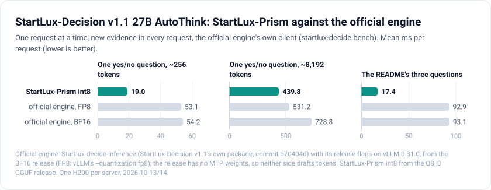
</picture>

<picture>
  <source media="(prefers-color-scheme: dark)" srcset="images/v11-official-throughput-dark.svg">
  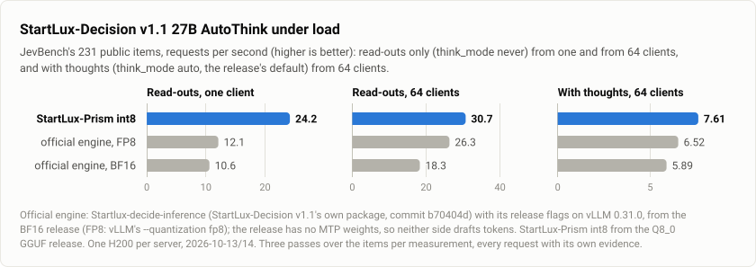
</picture>

**The servers:**
- **Official engine:**
  - Software: Startlux-decide-inference at commit `b70404d` (package 1.1.0). Its own test suite passes (222 tests).
  - Serving: `startlux-decide serve --model DIR --launch-vllm --gpus N`, with the release flags its launcher picks
    for vLLM 0.31.0 (torch 2.13.0+cu130). That means prefix caching and chunked prefill at 8,192 tokens, a 262,144-token
    context, a GPU memory share of 0.88, images on, and thoughts as one streamed request.
  - Weights: the BF16 release `startlux-models/StartLux-Decision-v1.1-27B-AutoThink`. The weights commit is `46072ef`
    (the latest commit, `869e181`, only adds the model card). The download is 54.7 GB in 14 shards; every file's
    SHA-256 was checked against Hugging Face.
  - FP8: the same server with `--quantization fp8`.
  - No MTP: the folder's config declares one MTP layer, but the release ships no `mtp.*` tensors, so the launcher
    turns MTP speculative decoding off ("no MTP (the folder holds no MTP weights)").
- **StartLux-Prism int8:** the Q8_0 GGUF release (SHA-256 `28757be9...`, the same file as above) with its mmproj, server
  defaults (64 thoughts at once), at this repository's commit `6e47e4d`.
- **What differs between the two sides:**
  - The weights. The official engine reads the BF16 release; StartLux-Prism reads the Q8_0 GGUF made from it, so
    StartLux-Prism's weight values carry Q8_0's rounding.
  - The thought sampler. Both sample at T 0.6, top-k 20, top-p 0.95 with the same seeds, but the random number
    generators differ, so the two sides write different thoughts.
  - The linear-attention state. vLLM keeps the recurrent state of thoughts in bf16 (`mamba_ssm_cache_dtype` auto
    takes the model's dtype); StartLux-Prism keeps it in fp32.

**Clients.** Requests that time one at a time come from the official engine's own client (`startlux-decide bench`),
with 5 warm-up requests dropped from the 25 of each file. Its `--warmup` would replay the file's first requests,
which would then be timed as prefix-cache hits. Every request has its own evidence. JevBench runs use
`bench/run_jevbench.py` and JevBench's own scorer.

**One request at a time** (mean ms; p50 and p95 within 2% of the mean for one-pass requests):

| request | official, BF16 | official, FP8 | **StartLux-Prism int8** | StartLux-Prism bf16 |
|---|---|---|---|---|
| one yes/no question, ~256 prompt tokens | 54.2 | 53.1 | **19.0** | 25.5 |
| ~1,024 tokens | 116.3 | 114.5 | **57.6** | 89.2 |
| ~4,096 tokens | 375.0 | 272.4 | **214.3** | 348.6 |
| ~8,192 tokens | 728.8 | 531.2 | **439.8** | 722.2 |
| the official README's three questions, `think_mode` never | 93.1 | 92.9 | **17.4** | 23.8 |
| the same, `think_mode` auto (109 of 165 questions think) | 1,775 | 1,296 | **785** | 1,542 |

StartLux-Prism bf16 (weights dequantized from the Q8_0 GGUF) ran this table only.

**JevBench, read-outs only** (`think_mode` never; requests/s over three passes of the 231 items):

| clients | official, BF16 | official, FP8 | **StartLux-Prism int8** |
|---|---|---|---|
| 1 | 10.6 | 12.1 | **24.2** |
| 16 | 17.8 | 25.8 | **29.9** |
| 64 | 18.3 | 26.3 | **30.7** |
| correct per pass, of 231 | 212-213 | 211-214 | 212-216 |

One request at a time, StartLux-Prism's read-outs take less than half the time. From many clients, both engines are bound
by the GPU's tensor cores, which run int8 and FP8 at the same rate on an H200, and StartLux-Prism's lead narrows to 17%.

**JevBench with thoughts, one request at a time** (`think_mode` auto, the release's default):

| | official, BF16 | official, FP8 | **StartLux-Prism int8** |
|---|---|---|---|
| correct, of 231 | 226 | 225 | 224 |
| mean / p50 / p95 ms per item | 1,702 / 56 / 11,481 | 1,150 / 55 / 6,713 | 1,212 / **21** / 6,961 |
| items without a thought, mean ms | 79 | 68 | **31** |
| items that thought (right after the thought) | 66 (62) | 66 (61) | 67 (61) |
| thought tokens, mean / p50 / max | 350 / 226 / 1,651 | 342 / 268 / 1,429 | 369 / 135 / 3,948 |
| thought tokens/s, one sequence | 63 | **94** | **94** |
| requests/s | 0.59 | **0.87** | 0.83 |

Thoughts are generated at the same speed on StartLux-Prism int8 and on the official engine's FP8, at 94 tokens per
second for one sequence. Per token, the two take the same time. StartLux-Prism's mean is higher only because of one
3,948-token thought; the official engine's longest is 1,429 tokens.

**JevBench with thoughts from many clients** (`think_mode` auto, requests/s over three passes):

| clients | official, BF16 | official, FP8 | **StartLux-Prism int8** |
|---|---|---|---|
| 16 | 3.77 | 4.66 | **4.94** |
| 64 | 5.89 | 6.52 | **7.61** |
| correct per pass, of 231 | 224-229 (mean 226.5) | 221-228 (225.2) | 219-222 (220.5) |

**StartLux-Decision v1's evaluation suites with thoughts** (`think_mode` auto, 12,351 decisions from 16 clients, the
three servers at once, so the times compare only roughly):

| server | Easy | Original | Hard | Typed | ToolACE | AG News | WildJB | Average | Brier (Hard) | ECE (Hard) | time |
|---|---|---|---|---|---|---|---|---|---|---|---|
| official, BF16 | 100.00 | 100.00 | 94.59 | 78.20 | 95.48 | 90.83 | 91.67 | 92.97 | 0.0999 | 0.0547 | 1,252 s |
| official, FP8 | 100.00 | 98.61 | 94.59 | 78.35 | 95.81 | 90.71 | 91.72 | 92.83 | 0.1044 | 0.0443 | 957 s |
| **StartLux-Prism int8** | 100.00 | 98.61 | 94.59 | 78.50 | 96.13 | 90.83 | 91.90 | 92.94 | 0.1093 | 0.0531 | **750 s** |

StartLux-Prism's scores are those of its earlier run ([thinking](#startlux-decision-v11-27b-autothink-thinking)), to the
digit, although the questions now came from 16 clients at once.

**Accuracy with thoughts, many samples.** One thought per question, as in the suites, puts the three servers level.
Many thoughts per question show a small gap. In the many-client JevBench runs every request carries its own request
number, so every pass draws new thoughts. Over nine samples of the 231 items, StartLux-Prism int8 averages 221.2 correct,
against 226.0 for the official BF16 server and 224.9 for FP8. Without thoughts the three score the same.

A cross-read experiment locates it. The setup:
- **Questions:** the 67 JevBench items that thought, each with 3 request numbers, `think_mode` always (201 thoughts per
  writer).
- **Reading:** every thought read twice: by the official engine's read-out (vLLM completions, as its backend reads)
  and by StartLux-Prism int8. Each read is mixed with the writer's own first read-out.
- **Check:** a writer's own read-out rebuilt this way gives the probabilities its server reported (StartLux-Prism: bit for
  bit).

| thoughts written by | official read-out | StartLux-Prism int8 read-out |
|---|---|---|
| official engine, BF16 | 187 | 185 |
| StartLux-Prism, bf16 (the Q8_0 weights dequantized) | 186 | 185 |
| StartLux-Prism int8 | 180 | 178 |

What the experiment shows:
- **The gap is in writing the thoughts:** int8 thoughts lose about 7 of 201 questions whoever reads them.
- **Reading costs little:** reading with int8 costs 1 or 2.
- **The cause is the int8 activations:** thoughts written with bf16 arithmetic on the same Q8_0 weights are as good as
  the official engine's. The int8 path quantizes every activation row of a decode step to int8 with one scale per row,
  and over a long generation the error shows. Read-outs see it far less.

**StartLux-Prism int8 against StartLux-Prism bf16** on the same Q8_0 weights (bf16: the blocks dequantized, cuBLAS), one H200.

<picture>
  <source media="(prefers-color-scheme: dark)" srcset="images/v11-precision-dark.svg">
  
</picture>

Prefill (`bench/prefill_speed.py`):

| one prompt per pass | 256 tokens | 1,024 | 4,096 | 8,192 | 16,384 | 32,768 | passes of 8,192 tokens (32 x 256, 64 x 128, 8 x 1,024) |
|---|---|---|---|---|---|---|---|
| int8 | 17.5 ms | 54.3 | 208.9 | 426.2 | 915.4 | 2,072.6 | 20,750-20,855 tokens/s |
| bf16 | 25.2 ms | 88.5 | 349.4 | 717.1 | 1,492.8 | 3,226.8 | 11,912-11,958 tokens/s |
| int8 faster by | 1.44x | 1.63x | 1.67x | 1.68x | 1.63x | 1.56x | 1.74-1.75x |

Decode (`bench/decode_speed.py`, ms per step / tokens per second):

| sequences, context | 1, 512 | 8, 512 | 64, 512 | 1, 4,096 | 8, 4,096 | 64, 4,096 |
|---|---|---|---|---|---|---|
| int8 | 10.47 / 95.5 | 11.06 / 723 | 16.70 / 3,832 | 10.56 / 94.7 | 11.41 / 701 | 20.31 / 3,152 |
| bf16 | 14.89 / 67.1 | 15.90 / 503 | 21.74 / 2,944 | 14.98 / 66.8 | 16.24 / 493 | 25.37 / 2,522 |
| int8 faster by | 1.42x | 1.44x | 1.30x | 1.42x | 1.42x | 1.25x |

Decode streams the weights, which are half as large in int8, but the int8 path reaches about 2.6 TB/s against
cuBLAS bf16's 3.6 at one sequence ([Open](optimizations.md#open)). At 64 sequences the linear-attention states, fp32 on
both paths, take a third of a step.

Through the server (JevBench, requests/s; correct per pass of 231):

| | one client | 16 clients | 64 clients | correct per pass |
|---|---|---|---|---|
| int8, read-outs | 24.2 | 29.9 | 30.7 | 212-216 |
| bf16, read-outs | 14.9 | 16.7 | 16.9 | 213 |
| int8, with thoughts | 0.84 | 4.94 | 7.61 | 219-222 (mean 220.5) |
| bf16, with thoughts | 0.51 | 3.40 | 4.14 | 224-228 (mean 226.2) |

## Images

StartLux-Decision-v1.1-27B-AutoThink's Q8_0 GGUF with its vision file (`mmproj-StartLux-Decision-v1.1-27B-AutoThink-F16.gguf`,
0.93 GB, SHA-256 `b6ff3c746a642ac44ea14f679f3a6e788a8b7c2cb4474378fa895e86f1b937eb`), one H200, 2026-10-13. The image
requests are `bench/vision_suite.py`'s: synthetic images with a right answer for every question (shapes and colours,
rendered text such as an invoice, signs and a shipping label, counting), 1 to 8 images per request, sizes from 32 x 32
to 2,400 x 1,600 pixels, aspect ratios up to 20:1.

**Against transformers** (`tests/vision_reference.py`): `Qwen3_5ForConditionalGeneration` on a bf16 checkpoint converted
from the same Q8_0 GGUF and mmproj (`startlux_prism/tools/gguf_to_hf.py --mmproj`), 24 image requests with 53 questions, and
11 text questions as the yardstick:

| StartLux-Prism | same decision (images) | max \|Δp\| | mean \|Δp\| | max \|Δlogit\| | text: max / mean \|Δp\| |
|---|---|---|---|---|---|
| bf16 | 53 of 53 | 0.0042 | 0.00008 | 0.093 | 0.0048 / 0.00056 |
| int8 | 53 of 53 | 0.046 | 0.00044 | 2.26 | 0.053 / 0.0040 |

transformers, bf16 and int8 answer all 53 questions right. The vision tower alone gives transformers'
`Qwen3_5VisionModel` features bit for bit (same weights, same attention kernel) on 9 sizes from 64 to 1,024 tokens.

**The vision tower** (bf16, one image):

| tokens per image | eager | as served |
|---|---|---|
| 64 | 6.4 ms | 2.1 ms (CUDA graph) |
| 256 | 6.3 ms | 3.9 ms (CUDA graph) |
| 576 | 10.4 ms | 9.7 ms (CUDA graph) |
| 1,024 | 18.7 ms | 18.7 ms (no graph above 576 tokens) |

transformers' own module takes 60-75 ms per image.

**End to end** (int8 server, one request at a time, two questions, new images in every request; `bench/vision_latency.py`):

| image size | 1 image | 4 images | 8 images |
|---|---|---|---|
| 1024 x 1024 | 126 ms | 407 ms | 794 ms |
| 512 x 512 | 40 ms | 120 ms | 216 ms |
| 256 x 256 | 22 ms | 48 ms | 84 ms |

At 1024 x 1024 the GPU time is 82 / 288 / 580 ms and decoding the images 35 / 85 / 144 ms. Text requests take the
same time with the tower loaded: seven latency suites, two rounds each, within 0.3 ms of the server without it, whose
own rounds differ by up to 0.47 ms.

**With thoughts.** The same 53 questions with `think_mode` `"always"`:
- every question thinks (29 tokens on average), and the thoughts describe the images ("Evidence shows large red
  circle");
- all 53 answers are right;
- the first read-outs equal the one-pass answers;
- two runs give the same thoughts and probabilities;
- a request takes 649 ms, against 30 ms in one pass.

## Several GPUs: data parallelism

`python -m startlux_prism.dp`: one StartLux-Prism int8 server per GPU behind the router (README, Serving), StartLux-Decision-v1.1-27B-AutoThink on
GPUs 1-3 of the second H200 server, 2026-10-14; JevBench as above (requests/s over three passes, each request with its own
evidence).

| | one GPU | three GPUs | |
|---|---|---|---|
| one request at a time, read-outs: mean / p50 ms | 41.1 / 15.8 | 42.2 / 14.8 | the router's hop: about 1 ms |
| read-outs, 1 client | 24.2 | 23.4 | |
| read-outs, 64 clients | 30.7 | **88.7** | 2.89x |
| read-outs, 192 clients | | 89.4 | |
| with thoughts, 64 clients | 7.61 | 13.5 | |
| with thoughts, 192 clients | | 14.1 | 1.85x |

The 231 items one at a time through the three workers gave the single GPU's decisions and probabilities. With
thoughts, a three-pass run cannot end before its longest thought: one of about 4,000 tokens takes some 40 s on its
own, so the gain shows in longer runs.

Four GPUs as four one-GPU servers, two 2-GPU servers or one 4-GPU server:
[Four H200s: the most throughput](#four-h200s-the-most-throughput).

## Tensor parallelism: the 27B on 2 and 4 H200s

StartLux-Decision-v1.1-27B-AutoThink (the Q8_0 file of [the thinking section](#startlux-decision-v11-27b-autothink-thinking),
int8) with `--tp 2` and `--tp 4` (`startlux_prism/tp.py`), on the second H200 server: eight H200s on NVSwitch (NV18 between
every pair), torch 2.14.1, Triton 3.8.0, NCCL 2.30.7, 2026-10-14. Two GPUs ran on GPUs 1-2, four on GPUs 3-6, one on
GPU 6 (speed) and GPU 1 (server), at most two configurations at a time on disjoint GPUs (other users' jobs ran on GPUs
0 and 7). Every answer is the single GPU's, bit for bit (README, [Correctness](../README.md#correctness)): letter
logits, prefix-cache hits, batches, wide choices, decode logits and tokens, images, and JevBench with thoughts through
the server.

**Prefill** (`bench/prefill_speed.py --tp N`; ms per pass, from launch to the logits on the host, median of 10):

| prompt | 1 GPU | 2 GPUs | 4 GPUs |
|---|---|---|---|
| 256 tokens | 17.49 | 17.32 (1.01x) | 15.12 (1.16x) |
| 1,024 tokens | 54.07 | 45.11 (1.20x) | 37.32 (1.45x) |
| 4,096 tokens | 210.3 | 155.1 (1.36x) | 125.8 (1.67x) |
| 8,192 tokens | 427.6 | 301.2 (1.42x) | 241.6 (1.77x) |
| 16,384 tokens | 919.6 | 621.7 (1.48x) | 485.1 (1.90x) |
| 32,768 tokens | 2,092.6 | 1,402.8 (1.49x) | 1,032.8 (2.03x) |
| 32 prompts of 256 tokens in one pass | 398.3 | 275.8 (1.44x) | 214.8 (1.85x) |

(64 prompts of 128 tokens and 8 of 1,024 take the same time as 32 of 256, within a millisecond.) Short prompts gain
little: at 256 tokens two GPUs are no faster than one, four 1.16x. From 1,024 tokens on, two GPUs give 1.2-1.5x and
four 1.45-2.0x.

**Decode** (`bench/decode_speed.py --tp N`; ms per step, every sequence one token per step):

| sequences decoding at once | 1 | 2 | 4 | 8 | 16 | 32 | 64 |
|---|---|---|---|---|---|---|---|
| 1 GPU, prompts of 512 tokens | 10.47 | 10.44 | 10.73 | 11.07 | 11.95 | 13.53 | 16.69 |
| 2 GPUs | 7.68 | 7.71 | 7.98 | 8.15 | 9.03 | 10.54 | 12.93 |
| 4 GPUs | 6.51 | 6.61 | 6.82 | 7.18 | 7.63 | 8.81 | 10.14 |
| 1 GPU, prompts of 4,096 tokens | 10.57 | 10.57 | 10.92 | 11.41 | 12.78 | 15.29 | 20.30 |
| 2 GPUs | 7.75 | 7.81 | 8.11 | 8.33 | 9.36 | 11.37 | 14.70 |
| 4 GPUs | 6.56 | 6.67 | 6.92 | 7.34 | 7.81 | 9.15 | 10.98 |

A lone thought's step: 10.5 ms on one GPU, 7.7 on two (1.36x), 6.5 on four (1.61x); 64 thoughts at once with
4,096-token prompts 1.38x and 1.85x.

**The all-reduces' share** (`STARTLUX_PRISM_TP_ABLATE=1`: every GPU computes its shard without them - wrong results, the
time of the rest; share = 1 - without / with):

| | 256 tokens | 1,024 | 4,096 | 8,192 | 16,384 | 32 x 256 | decode, 1 sequence | 8 | 64 |
|---|---|---|---|---|---|---|---|---|---|
| 2 GPUs | 32% | 28% | 23% | 21% | 19% | 22% | 11% | 12% | 23% |
| 4 GPUs | 43% | 42% | 42% | 42% | 40% | 43% | 21% | 28% | 31% |

Without them four GPUs would prefill 2.0x (256 tokens) to 3.1x (16,384) faster than one; the rest of the gap is what
does not divide by four (the replicated norms and residual, each kernel's fixed cost: a one-sequence step without the
all-reduces still takes 5.1 ms at 4 GPUs, 6.8 at 2). What remains is mostly NCCL's int32 sums of the output
projections on every pass of more than 4 tokens (4 GPUs) or 128 (2 GPUs): the maxima travel inside the kernels, and
the sums of the shortest passes are read by their consumer
([optimizations](optimizations.md#tensor-parallelism-one-27b-over-2-or-4-h200s-2026-10-14): what was measured, kept
and dropped).

**JevBench through the server** (`python -m startlux_prism.server --tp N`, `bench/run_jevbench.py`, the 231 public items;
the memory in use on the first GPU after start, every configuration with the same buffers: 131,072 tokens per pass,
the 64-entry prefix cache, 64 thoughts at once with their KV rows):

| GPUs | think_mode never, one at a time: mean / p50 / p95 ms | never, requests/s from 16 / 64 clients | auto, one at a time: mean / p50 ms | auto, the 67 thinking items' mean | auto, requests/s from 16 / 64 clients | GPU memory in use |
|---|---|---|---|---|---|---|
| 1 | 41.0 / 14.2 / 146 | 29.9 / 30.9 | 1,209 / 19.5 | 4.09 s | 5.07 / 6.28 | 113.9 GiB |
| 2 | 34.4 / 14.9 / 114 | 40.6 / 43.3 | 902 / 19.4 | 3.04 s | 6.56 / 8.26 | 64.0 GiB |
| 4 | 29.0 / 12.4 / 93 | 49.8 / 54.0 | 768 / 17.0 | 2.59 s | 7.75 / 9.81 | 37.7 GiB |
| 4: two servers of 2 (`startlux_prism.dp --tp 2`) | 36.0 / 15.7 / 118 | 77.0 / 84.0 | 902 / 19.9 | 3.04 s | 8.71 / 12.13 | 64.0 GiB |

Every configuration scores 214 of 231 without thoughts and 224 with them, the same 67 items thinking the same
thoughts. The many-client runs send three passes (never) or two (auto) of request-numbered items; the auto runs start
their request numbers at the same seeded value in every configuration, so the same items think the same thoughts
there too (223 and 220 right from 16 clients, 226 and 222 from 64, in all four). JevBench's mean falls 1.19x on two
GPUs and 1.41x on four without thoughts, 1.34x and 1.57x with them; the median item (a short prompt) hardly moves -
the long prompts and the thoughts carry the gain. From 16 and 64 clients: 1.36-1.40x and 1.66-1.75x without
thoughts, 1.29-1.32x and 1.53-1.56x with them.

**Both at once** (the last row): `python -m startlux_prism.dp --gpus 1,2,3,4 --tp 2`, two 2-GPU servers behind the router,
the same runs. The 231 items one at a time gave the single GPU's probabilities and thoughts, bit for bit, with and
without thoughts. On four GPUs, two 2-GPU servers answer 1.56x the read-outs of one 4-GPU server from 64 clients
(84.0 against 54.0 requests/s) and 1.24x with thoughts (12.13 against 9.81), each request at a 2-GPU server's speed
plus the router's hop (36.0 against 34.4 ms on average). The most each configuration answers:
[Four H200s](#four-h200s-the-most-throughput).

## Four H200s: the most throughput

Four GPUs three ways: four one-GPU servers behind the router (`python -m startlux_prism.dp --gpus 1,2,3,4`), two 2-GPU
servers (the same with `--tp 2`) and one 4-GPU server (`--tp 4`, [above](#tensor-parallelism-the-27b-on-2-and-4-h200s)).
StartLux-Decision-v1.1-27B-AutoThink in int8 on GPUs 1-4 of the second H200 server, 2026-10-14; JevBench's 231 items,
every request with its own request number; requests/s over the whole run.

**Read-outs** (think_mode never; five passes, 1,155 requests per level):

| clients | 32 | 64 | 128 | 192 | 256 |
|---|---|---|---|---|---|
| four one-GPU servers | | 118.5 | **121.1** | | 118.3 |
| two 2-GPU servers | 80.0 | 84.1 | **86.0** | 84.3 | 85.9 |
| one 4-GPU server (three passes) | | **54.0** | | | |

Both router configurations level off from 64 clients. Against one GPU (30.9 requests/s from 64 clients,
[above](#tensor-parallelism-the-27b-on-2-and-4-h200s)): four one-GPU servers 3.92x, two 2-GPU servers 2.78x, one
4-GPU server 1.75x - per GPU 30.3, 21.5 and 13.5 requests/s.

**With thoughts** (think_mode auto; the request numbers from the same seed in every configuration, so the same items
think the same thoughts and every pass scores the same in all of them):

| | 924 requests (four passes) from 64 / 128 / 192 / 256 clients | 3,696 requests (16 passes) from 256 clients | GPU memory in use, per GPU |
|---|---|---|---|
| four one-GPU servers | - / 14.18 / - / 14.43 | **26.11** | 113.9 GiB |
| two 2-GPU servers | 13.93 / 14.55 / 14.73 / 14.95 | 19.85 | 64.0 GiB |
| two 2-GPU servers, `--think-seqs 128` | - / 14.75 / - / 15.10 | | 79.0 GiB |

A run cannot end before its longest thought, about 4,000 tokens decoded a step at a time (10.5-20 ms per step on one
GPU, 7.7-14.7 on two, by the number of thoughts decoding with it). Over 924 requests (about a minute) that tail is a
large part of the run: the one-GPU servers' GPU was busy 51-54% of it (sampled on GPU 1; 99.7% for the 2-GPU servers),
and they trail. Over 3,696 requests the GPUs were busy 95-98% and the four one-GPU servers answer 1.32x as many
requests per second. Between the two run lengths (the 2,772 extra requests over the extra time) the rates are 35.8 and
22.3 requests/s (1.6x), nearer to what a queue that never drains would see. 128 thoughts decoded at once per server
instead of 64 (`--think-seqs 128`) add 1%.

So for throughput, one server per GPU; tensor parallelism shortens each request instead (one at a time: 29.0 ms per
read-out and 768 ms per item with thoughts on one 4-GPU server, 36.0 and 902 on two 2-GPU servers, 41.0 and 1,209 on
one GPU).

## Eight H200s: against the official engine

All eight GPUs of the second H200 server, 2026-10-14, each engine with its own data parallelism:
- **StartLux-Prism int8:** `python -m startlux_prism.dp --gpus 0,1,2,3,4,5,6,7`, eight one-GPU servers behind the router.
- **Official engine:** Startlux-decide-inference with its own launcher, `startlux-decide serve --launch-vllm --gpus
  0,1,2,3,4,5,6,7`: one vLLM 0.31.0 server per GPU behind its front end, the BF16 release with its release flags.

JevBench's 231 items, every request with its own request number; requests/s over the whole run.

**Read-outs** (`think_mode` never; 20 passes, 4,620 requests per level):

| clients | 128 | 256 | 512 | 1,024 |
|---|---|---|---|---|
| **StartLux-Prism int8** | **235.9** | **237.8** | **234.1** | **232.0** |
| official, BF16 | 130.8 | 137.5 | 136.5 | 135.5 |
| StartLux-Prism's lead | 1.80x | 1.73x | 1.71x | 1.71x |
| p50 / p95 ms, StartLux-Prism | 516 / 834 | 985 / 1,509 | 2,039 / 2,669 | 3,899 / 5,006 |
| p50 / p95 ms, official | 749 / 2,503 | 1,805 / 3,189 | 3,373 / 5,473 | 6,415 / 9,657 |

Both level off from 128-256 clients. StartLux-Prism's 237.8 requests/s is 7.7x one GPU's (30.9,
[above](#tensor-parallelism-the-27b-on-2-and-4-h200s)), 29.7 per GPU; the official engine's 137.5 is 17.2 per GPU
(one GPU: 18.3 from 64 clients, [above](#startlux-decision-v11-27b-autothink-against-its-official-engine)). Every pass
scored 211-216 of 231 on both.

**With thoughts** (`think_mode` auto, the release's default; 16 passes, 3,696 requests, the request numbers from one
seed, so both engines answer the same requests):

| clients | 256 | 512 |
|---|---|---|
| **StartLux-Prism int8** | **38.05** | **40.99** |
| official, BF16 | 27.42 | 29.86 |
| StartLux-Prism's lead | 1.39x | 1.37x |
| correct per pass, mean of 16: StartLux-Prism / official | 222.0 / 225.5 | 222.0 / 225.4 |
| the run / its longest request, s: StartLux-Prism | 97 / 86 | 90 / 85 |
| the run / its longest request, s: official | 135 / 108 | 124 / 109 |

These runs are bound by their tails: the longest request (a thought of up to 4,096 tokens, decoded among many) takes
most of the run, so both rates would rise in longer runs. Thoughts written by int8 score about 3 fewer per pass, the
gap the [cross-read above](#startlux-decision-v11-27b-autothink-against-its-official-engine) traces to int8
activations in decoding.

The official engine's FP8 setting answers 1.44x its BF16 on one GPU (26.3 against 18.3 requests/s from 64 clients);
it was not run on eight. The router raises its open-file limit to the hard limit when it starts: at the usual 1,024,
a first run ran out at 512 clients (every request in flight holds a client's connection and a worker's) and the
router died.

## Stress tests

`tests/test_stress.py` runs against a live server and fails on any broken promise (a few minutes per run, about two
with `--quick`): long evidence answered with every token counted (8k and 50k tokens), the capacity limit (a request just
inside the largest batch answered, one beyond it refused with HTTP 422, the server answering afterwards), 8k-token
requests from 8, 16 and 32 clients without a failed request, JevBench's 231 items from 8, 16 and 32 clients (three
passes per level, every pass within 3 of the score one at a time), 64 JevBench requests sent by 32 clients at once and
then one at a time with the same probabilities to the last bit (int8 and W4A8 are batch-invariant), and `/health` and
`/stats` at the end. Every run passed all 11 checks:

| model file, GPU, precision (date) | 8k / 50k evidence, p50 ms | largest batch: answered / refused | 8k evidence, 8 / 16 / 32 clients, req/s | JevBench, 8 / 16 / 32 clients, req/s (scores per pass; one at a time) | under load |
|---|---|---|---|---|---|
| v1-4B Q8_0, RTX 5090, int8 (10-10) | 163.6 / 1,918.6 | 65,046 tokens in 2.9 s / 66,581 | 6.15 / 6.09 / 6.07 | 82.9 / 83.9 / 83.0 (202-205; 205) | 64/64 identical |
| v1-9B Q8_0, RTX 5090, int8 (10-10) | 243.2 / skipped¹ | 48,679 tokens in 2.4 s / 50,203 | 4.08 / 4.03 / 4.01 | 52.5 / 53.0 / 53.2 (199-201; 200) | 64/64 identical |
| v1-4B Q4_K_M, RTX 5090, W4A8 (10-11) | 231.5 / 2,285.6 | 65,046 tokens in 3.4 s / 66,581 | 4.32 / 4.29 / 4.27 | 57.2 / 57.5 / 57.5 (198-202; 201) | 64/64 identical |
| v1-9B Q4_K_M, RTX 5090, W4A8 (10-11) | 364.0 / 3,110.4 | 65,046 tokens in 4.5 s / 66,581 | 2.72 / 2.69 / 2.67 | 34.3 / 34.7 / 34.7 (198-200; 200) | 64/64 identical |
| v1-27B Q8_0, H200, int8 (10-12) | 425.3 / 3,675.5 | 130,578 tokens in 14.7 s / 132,119 | 2.32 / 2.34 / 2.33 | 29.3 / 29.9 / 30.8 (206-209; 207) | 64/64 identical |
| v1-27B Q4_K_M, H200, W4A8 (10-12) | 1,711.4 / 11,444.7 | 130,578 tokens in 34.9 s / 132,119 | 0.59 / 0.59 / 0.59 | 7.2 / 7.4 / 7.5 (206-210; 207) | 64/64 identical |

¹ 50,005 tokens is beyond the 9B's largest batch with its prefix cache (49,152 tokens): the check is skipped, and the
capacity check covers the limit. Results: `results/stress/`.

The other engines under the same load: the many-client tables above (JevBench and 8k-token requests from 8, 16 and 32
clients on every model), where no engine failed a request.

## Engine configurations

* **StartLux-Prism** (`scripts/serve.sh start int8|bf16|w4a8`): CUDA graphs per token bucket (64 tokens up to the largest
  batch, sized from free GPU memory), tree-batched forward, W8A8 with SmoothQuant (int8), W4A8 (Q4_K_M) or cuBLAS bf16,
  pipelined scheduler (batches of up to 8,192 tokens; a longer request runs alone), direct execution on an idle server,
  prefix cache.
* **decider 1.9.0** (`uvicorn decider.serve:app`): default settings (CUDA graphs over a grid of 89 batch x length
  shapes, continuous batching, graph budget 32,768 tokens), and with its opt-in `DECIDER_COMPILE=1 DECIDER_FP8=1`
  (torch.compile and FP8 linears; its model card's fastest settings).
* **JevK5 0.3.3** (`python -m jevk5.server`): defaults.
* **StartLux-Decision server**: its `startlux_decision.server` on the converted bf16 checkpoint, transformers 5.19 with
  flash-linear-attention and causal-conv1d kernels and its CUDA-graph path.
* **SGLang 0.5.21**: defaults (FlashInfer attention on the RTX 5090, FlashAttention 3 on the H200, Triton GDN kernels,
  breakable prefill CUDA graphs, radix cache, default static memory fraction) with `--max-mamba-cache-size 160` (its
  default state pool capped it at 6 running requests; 96 for the 9B) and
  `SGLANG_UNIFIED_RADIX_TREE_CORE_BACKEND=python`.
* **SGLang 0.5.21 on the GGUF file** (`scripts/baselines.sh sglang-gguf`): the flags above, through
  `bench/adapters/sglang_gguf.py`; its GGUF kernels on the file's blocks, the token embedding dequantized to bf16.
* **vLLM 0.31**: `--gpu-memory-utilization 0.9` (its default), `--gdn-prefill-backend triton` (the FlashInfer GDN
  prefill crashed in CUDA-graph capture on sm_120), `-cc.backend=eager` (piecewise and full CUDA graphs without
  Inductor: torch.compile of this hybrid model did not finish in 25 minutes).
* **llama.cpp** b10639 `llama-server -ngl 99 -c 16384 --parallel 4` behind StartLux-Decision's `gguf_server` (the
  setting its model card gives).
* **Startlux-decide-inference** (StartLux-Decision v1.1's package, commit `b70404d`):
  - Command: `startlux-decide serve --model DIR --launch-vllm --gpus N` (add `--quantization fp8` for FP8).
  - vLLM: 0.31.0, with the flags its launcher picks (prefix caching, chunked prefill at 8,192 tokens, context
    262,144, `--gpu-memory-utilization 0.88`, `--logprobs-mode processed_logprobs --max-logprobs 26`,
    `--generation-config vllm`, images).
  - Thoughts: one streamed request each. There is no MTP, since the release holds no MTP weights.
* **Long evidence** (the 8k and 50k tables and the 8k-token clients): llama.cpp `-c 262144 --parallel 4`, vLLM
  `--max-model-len 65536`, SGLang `--context-length 65536`, decider `DECIDER_MAX_STATE_TOKENS=65536`; the rest as above
  (16,384 tokens of context otherwise).

## Crashes on the RTX 5090 server

Python processes on this server occasionally die with SIGSEGV or SIGILL at random points, in unrelated programs (a
plain `import torch`, gguf-py, SGLang's scheduler, torch.compile workers); RAM (48 GB x 4 patterns) and a CPU stress
test passed. In this comparison: SGLang's server died once during JevBench (rerun: completed), decider's default mode
crashed once at start (rerun: completed), and its torch.compile + FP8 mode crashed during compilation in 5 of 6
attempts with its own checkpoint and 2 of 3 with the stand-in before completing (`~/jev/logs/attempts/`). The SIGILLs
are raised by valid instructions: the two cores examined (gdb, apport) stopped on `mov 0x8(%r12),%rdx` in
`PyNumber_InPlaceAdd` and on `test $0x40,%al` in `PyUnicode_AsUTF8AndSize` of the system python3.12, a CPU failing to
execute valid code, not a program error. SGLang's GGUF launch (2026-10-11) died in about half the 4B launches and in
all nine 9B launches (the main process before its first log line, or the scheduler while loading); pinned with
`taskset` to the E-cores (CPUs 8-23) the 9B loaded 3 times out of 3, pinned to the P-cores (0-7, 5.5-5.7 GHz) once out
of 3. That points at the P-cores (BIOS settings, microcode 0x121, their boost), which needs the machine's
administrator. Every number above is from a run that completed without a crash; the H200 server showed none of this.
