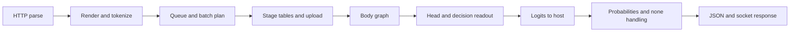

# MI355X next speedup study: native MXFP4 across the decision pipeline

Date: 2026-10-26. Status: **baseline refreshed; primary FP4 profile measured; optimization experiments pending**.
Working branch: `feat/mi355x`. Runtime baseline: `14d6e27`.

The objective is to reduce warmed, single-client **27B decision HTTP latency**,
especially `readme3`, while preserving decision quality and API behavior.
Native MXFP4 remains central: the next study must optimize the work surrounding
FP4 matrix multiplication as well as the multiplication itself.

This updates the earlier implementation plan in place. Completed FP4 enablement,
quality comparisons, tuning and rejected experiments remain in the
[execution results](mi355x_next_version_results.md). The first deliverable is a
current FP4 critical-path profile and an evidence-based attainable latency range;
the first optimization is chosen from that evidence.

## 1. Starting point and measurable objectives

The [matched measurement summary](../bench/results/mi355x_next_summary_20261026.json)
contains 4,500 HTTP samples: three rounds, 100 requests per suite and profile,
five suites, and three precision/configuration profiles. The selected FP4 path
uses original BF16 weights, paired H32 rotation, ceil E8M0 scales and native
scaled MFMA for all large projections.

| Suite | Previous tuned INT8 p50 | Updated INT8 p50 | Selected FP4 p50 / p95 | FP4 p50 goal | Further reduction needed |
|---|---:|---:|---:|---:|---:|
| `yesno` | 15.982 ms | 15.391 ms | 10.863 / 10.953 ms | ≤10 ms | 0.863 ms / 7.9% |
| `review1` | 18.306 ms | 17.633 ms | 12.413 / 12.513 ms | ≤11 ms | 1.413 ms / 11.4% |
| **`readme3`** | 20.658 ms | 20.150 ms | **14.557 / 14.682 ms** | **≤12 ms** | **2.557 ms / 17.6%** |
| `startlux3` | 34.599 ms | 30.423 ms | 22.030 / 22.122 ms | ≤23 ms | Already met historically |
| `longpage2` | 95.949 ms | 80.512 ms | 56.964 / 57.294 ms | ≤65 ms | Already met historically |

These historical matched timings precede the final PR scope cleanup. The fresh
2,500-call FP4 rebaseline now measures **14.693 ms p50 / 14.744 ms p95** for
`readme3`, leaving **2.693 ms / 18.3%** to reach 12 ms. It confirms the same
target status across all five suites on a different physical MI355X; it does
not establish a new speedup. See [parts 14–15](mi355x_next_version_results.md#part-14-current-runtime-fp4-rebaseline)
for current figures, device/telemetry limits and the primary graph profile.
**Use matched current-FP4 A/B runs for candidate claims.** The summary's
`baseline: 4534c11` describes the earlier INT8 comparison, not this study's
current-FP4 baseline.

The 12 ms goal is an engineering target, not an established hardware lower bound.
A 9 ms `readme3` result remains a stretch goal. If profiling shows that either
requires an unqualified numerical or workload change, document the gap and
deliver the validated smaller gain. Do not replace the workload to reach it.

No suite may regress by more than 3% in p50 or p95 against the new baseline,
after accounting for measurement uncertainty. Retain that non-regression gate even
where a historical target has already been met.

## 2. Freeze the workload and numerical contract

Use one MI355X, one model replica, one persistent HTTP client and
`/v1/systemone`. Keep thinking disabled, text-only causal decisions, graphs
enabled and cross-request prefix caching disabled. Retain normal constant
system-prefix handling, within-request evidence sharing, question order,
none-option behavior, probabilities, usage accounting and readout semantics.

Freeze these inputs in each experiment manifest:

- Model `startlux-models/StartLux-Decision-v1.1-27B-AutoThink`, revision
  `dd62d5cd84a483d75bdd548880bbf08bdd3f67a4`; original BF16 source hashes,
  tokenizer/configuration, converted FP4 artifact and its manifest hashes.
- Selected all-large-projection H32/ceil recipe. Norms, recurrent state,
  embeddings and decision readout retain their validated higher precision.
- Git commit plus any patch, immutable container image ID, Python, PyTorch,
  HIP, Triton, driver, compiler options, active tuning table and source identities.
  Start with Python 3.12, PyTorch `2.14.0+rocm10.1.0`, HIP `7.16.26385`,
  Triton `3.8.0`; a stack change is its own candidate.
- GPU UUID/PCI address, visible ordinal, partition mode, power limit, clocks,
  temperature and competing processes. Historical HIP device 0 was PCI
  `0000:75:00.0`, management index 3; discover the mapping before each run.
- Exact [frozen HTTP bodies](../bench/results/mi355x_fp4_frozen_20261026.json),
  server flags, thread counts, graph buckets and warm-up procedure.

Record live body tokens, body bucket, decision reads/head bucket, segment count
and batch size for every suite. Historical HTTP body geometries were
`yesno 55/64`, `review1 77/128`, `readme3 155/192`,
`startlux3 372/384`, `longpage2 1194/1280`; verify them again.
The older synthetic `144/192`, `361/384` and `1185/1280` profiles do not
represent the matching HTTP requests.

After the primary suite, test lengths immediately around graph-bucket
boundaries, larger question/option counts, none-option cases and mixed request
sizes. Stay within the qualified FP4 scope: single-GPU causal text decisions,
at most 16,384 packed tokens. Longer-than-captured requests must be labeled as
eager or given a separately measured capture configuration. Decode, vision and
tensor-parallel FP4 are separate enablement work.

## 3. Measure the complete critical path first



Inside the body/head, separate projection producers, H32 rotation/quantization,
packing and scale writes, FP4 GEMMs, GDN, attention and residual/norm work.
Attribute shared work once. For multi-pass none handling, record every engine
invocation belonging to the request.

| Boundary | Required measurement | Question answered |
|---|---|---|
| Client send → full response | Monotonic wall time, persistent connection, p50/p95 | Is the user-visible decision faster? |
| Parse/render/tokenize | CPU spans and calls per request | Is CPU preprocessing material for short requests? |
| Queue → prepare → launch | Existing scheduler timings plus batch geometry | Is waiting or batch construction dominating? |
| Upload → body → head → download | HIP events and a correlated CPU/GPU timeline | Where is the GPU stream spending time? |
| Producer → packed FP4 → projection output | Separate and combined timings, shape/call count, bytes | Does fusion or a GEMM change save the complete path? |
| GDN/attention/norms | Per-family totals and top individual shapes | What becomes dominant after FP4? |
| Completion → decision → serialized response | CPU spans, transfers and synchronization | How much latency remains after GPU work? |

### Instrumentation deliverables

1. **Implemented for one-pass text decisions:** [`bench/profile.py`](../bench/profile.py)
   accepts the explicit FP4 artifact/recipe and frozen HTTP rendering through
   `--manifest`. `--gemm-detail` covers native FP4 quantization/GEMM as well as
   INT8; `--graph-trace` records graph execution. Primary HTTP geometry matches.
   Complete stage measurements for the other suites and add separate multi-pass
   attribution before extending claims to wide decisions.
2. Use the existing stream-event timing support and add bounded diagnostic
   ranges around missing stages. In [the engine](../startlux_prism/engine/model.py),
   `gpu_ms` / `launch_to_logits_ms` are host wall time, not pure kernel time.
   `stream_elapsed_ms` spans stream work including transfers. Neither should
   be relabeled as matrix compute time.
3. Add completion/serialization coverage to the diagnostic harness:
   [server](../startlux_prism/server.py) `latency_ms` is computed before JSON
   serialization and socket delivery. Client timing remains the release metric.
4. Capture graph-enabled timelines for attribution and eager traces for kernel
   inspection. Measure instrumentation overhead against an uninstrumented run;
   collect hardware counters separately from release timing.
5. Reconcile the timeline with request wall time. Explain overlaps, idle gaps,
   nested spans and unaccounted time; investigate gaps exceeding 5% of latency.
   Do not add overlapping eager durations to claim an HTTP latency breakdown.

**Deliverable:** one table per suite with critical-path milliseconds, call
counts, body/head shapes, overlap and the top three sources of avoidable time.
The old INT8 split (72.8% GEMM, 18.5% GDN) is historical context; it cannot
establish the current FP4 priority order.

The first matching FP4 graph trace attributes approximately **53.4%** of summed
kernel duration to GEMM, **15.1%** to rotation/quantization/packing, and **22.4%**
to GDN. Body/head graph medians are **14.127 / 0.152 ms**. These diagnostic
measurements prioritize A–C below; they do not yet supply repeated per-stage
ceilings or the complete five-suite critical-path table.

## 4. Establish a reasonable bandwidth/compute envelope

AMD specifies 8 TB/s memory bandwidth and approximately 10.0663 PFLOPS dense
MXFP4 matrix peak for MI355X. These are device ceilings; short, padded
projections and mixed-precision request processing do not run continuously at
that peak. [AMD MI355X datasheet](https://www.amd.com/content/dam/amd/en/documents/instinct-tech-docs/product-briefs/amd-instinct-mi355x-gpu-brochure.pdf)

The earlier [device measurements](mi355x_performance.md) reached about
5.77 TB/s streaming-copy bandwidth. Large library INT8/BF16 products are useful
stack checks, but do not establish native FP4 speed at this model's shapes.

For the current stack, measure a large native-FP4 reference and the actual
projection `M/N/K` shapes, live rows and head sizes. Rotate through weights
larger than the last-level cache as well as measuring realistic graph reuse.
Check generated scaled-MFMA instructions; calling `dot_scaled` alone does not
prove native execution on every backend.
[Triton microscaled product documentation](https://triton-lang.org/main/python-api/generated/triton.language.dot_scaled.html)

For each expensive stage report:

- Useful operations, with one multiply-add counted as two, separately from
  issued operations including padded rows/tiles; use TFLOP/s for FP4 and TOPS
  for integer arithmetic, with the precision named.
- Minimum tensor bytes, measured traffic at each available memory level,
  activation traffic, repeated weight reads, scale/auxiliary-layout traffic,
  and achieved rate. MXFP4's logical storage is 17 bytes per 32 values
  (0.53125 bytes/value), before extra layouts and buffers.
- Applicable measured bandwidth and compute ceilings, registers, spills, LDS,
  occupancy and launch/reduction costs. For mixed kernels, identify scalar,
  vector or matrix limits instead of dividing everything by FP4 peak.

An optimistic stage estimate is
`max(required_bytes / attainable_bandwidth, issued_ops / attainable_compute)`,
plus non-overlapped dependencies/launch costs. Apply it to the dependency graph,
using consistent memory levels and shapes. A measured ceiling is an empirical
reference, not a proven physical bound. Report an optimistic estimate and a
conservative achievable scenario with assumptions.

On CDNA 4, L2-to-fabric traffic must not automatically be labeled HBM traffic:
last-level cache can service requests. Name counter domains and avoid inferring
physical HBM bandwidth from `FetchSize` alone.
[ROCm Compute Profiler L2 metric definitions](https://rocm.docs.amd.com/projects/rocprofiler-compute/en/docs-10.1.0/conceptual/cdna/l2-cache.html)

Rank candidates by milliseconds saved on the critical path:
`potential_saving = exposed_stage_ms × (1 - 1 / stage_speedup)`.
For example, doubling a 1 ms exposed stage saves only 0.5 ms; it cannot close
the current 2.693 ms primary gap alone. Label assumed speedups as hypotheses. Replace
the old unmeasured per-stage 12 ms allocation with this measured budget.

## 5. Experiments, ordered by the profile

The order below is the initial hypothesis. Promote a later item if its measured
critical-path opportunity is larger. Run one intervention at a time and retain
only changes that improve the complete request.

| Study | Concrete work | Evidence required to advance |
|---|---|---|
| A. FP4 producer and packing fusion | Fuse add/norm, gated norm or SwiGLU producers with H32 rotation, activation quantization and scale/packing stores where dependencies permit. | Reduced combined producer-to-GEMM latency and traffic; identical selected quantized payload/scales and preserved rounding boundaries. |
| B. FP4 projection efficiency | Tune the dominant actual body/head shapes: tiles, weight reuse, workgroup/XCD ordering, scale layout and output handling. Compare a library candidate only as a complete usable path. | ISA/counters explain the gain; quantization, layout conversion, epilogue and tail costs are included; no silent fallback. |
| C. GDN and attention | Target the largest remaining intra/recurrent/output or attention stage. Evaluate scheduling, layout or fusion while preserving validated state/reduction behavior. | Meaningful exposed milliseconds saved, exact state/isolation checks where required, graph and mixed-batch parity. |
| D. Host, graphs and readout | Reduce measured render/plan allocations, staging copies, launch gaps, completion waits or serialization cost. Evaluate closer graph buckets only if padding is costly. | Client p50/p95 improve with identical API work; graph count, capture cost and memory remain bounded. |
| E. Concurrency | After single-client qualification, study batch policy and overlap at fixed arrival rates and concurrency. | Requests/s and decisions/s improve under a stated p95 latency SLO, without queue instability or unfairness to long requests. |
| F. Startup and memory | Separately study streaming original-weight loading/direct packed loading with integrity checks retained. | Lower peak memory and cold-start time; warmed latency reported separately. |

For A, [`Engine._project`](../startlux_prism/engine/model.py) currently launches
`quantize_into` before each packed projection. Account for canonical and
shuffled scale buffers; removing an intermediate BF16 store must preserve its
rounding effect. Fusion is a candidate, not an assumed win: added register
pressure or repeated quantization across output tiles can erase the saving.

For B, start from the current qualified FP4 table.
`STARTLUX_PRISM_MXFP4_GEMM=reference` selects an older conservative tile,
so beating it does not establish a gain over the shipping candidate.
Similarly, `STARTLUX_PRISM_MI355X_GEMM=baseline` is not the tuned INT8 baseline.

Log the active configuration for every shape. The
[FP4 implementation](../startlux_prism/kernels/mxfp4.py) checks GPU, runtime
versions and source identity before using its tuning table. Kernel edits can
invalidate that table and select fallback settings. Rebuild and requalify
affected entries; retain the guards. Quantizer source changes also require
artifact identity handling and equivalence/quality validation.

For C, the selected MI355X GDN settings already use
`INTRA_WARPS=4, HREC_BV=64, OUT_BV=64, HREC_NS=1, OUT_NS=1`.
Measure the remaining opportunity before repeating tuning.

Do not repeat the following without a new counter-based hypothesis or changed
implementation/stack: earlier AITER full paths, very wide M tiles, the
shared-weight 128+tail prototype, and recurrence `NS=2` that hit a compiler
dominance failure. Earlier plain-ceil, MSE-scale and MLP-only recipes scored
211/231, 209/231 and 208/231, respectively; the selected rotated recipe scored
213/231. Recipe changes belong to a separate quality study.

For each hypothesis, predeclare the targeted stage, predicted milliseconds,
correctness risk and a small candidate budget (initially 6–12 configurations).
Stop after two rounds without a repeatable complete-path gain unless new
profiling evidence changes the hypothesis.

## 6. Performance and correctness gates

### Matched performance comparisons

[`bench/mi355x_next_http.py`](../bench/mi355x_next_http.py) now supports two
immutable images using the **same selected FP4 recipe** through
`--profiles mxfp4-r32 --image BASE_IMAGE --candidate-image CANDIDATE_IMAGE`.
It alternates order, verifies complete answer/usage parity, saves server timings
and emits per-round medians and pooled p50/p95. Paired confidence/drift analysis
and actual optimization candidates remain to be evaluated.

Run at least five paired server rounds, alternating baseline/candidate order,
with at least 100 measured calls per suite per round after warm-up. Warm all
measured graph buckets and wait for compilation/clock stabilization. Run
candidates sequentially on the same isolated GPU; counter collection and other
GPU workloads must not overlap release measurements.

Save every sample. Report per-round medians, pooled p50/p95, paired changes and
a 95% confidence interval computed at the round/block level. Add rounds if
uncertainty is too large; do not treat autocorrelated requests as independent
evidence. Investigate baseline drift above 3% before drawing a conclusion.
Use repeated medians for microbenchmarks, not best-of timings as release proof.

Initial acceptance rule: a positive paired improvement with uncertainty
excluding zero, and at least 0.2 ms or 2% `readme3` reduction, with the all-suite
non-regression gate. A targeted improvement on another suite may be accepted
if explicitly scoped. Smaller changes need a clear cumulative benefit rather
than another unsupported speed claim. Compare the combined final candidate
again; individual savings need not add.

### Numerical behavior and quality

- Speed-only packing/layout/fusion changes preserve the selected FP4 values,
  scales and required rounding boundaries. Check zero/tie/scale-boundary
  inputs, tails, masked rows, all relevant shapes and real layer activations.
- Validate native products against independent high-precision arithmetic on
  the same quantized operands, using the existing numerical contract.
  Check full-model outputs, probabilities and near-tie decisions, plus
  eager/graph, alone/mixed/reordered batches and cache miss/hit/eviction.
- Require exact parity for affected INT8 behavior. Shared GDN/host changes must
  preserve the fallback and API semantics, including none handling and usage.
- Original BF16 and selected FP4 both scored 213/231 on public JevBench, but
  had six different argmax predictions. Equal aggregate scores do not establish
  equal decisions or complete quality qualification. This repeatedly used
  public set is a development set.
- Freeze a separate representative held-out set before evaluating recipe or
  arithmetic changes. The earlier proposed loss budgets (≤0.5 percentage point
  aggregate and ≤1 point per slice versus BF16) remain provisional: define the
  application acceptance threshold, sample size and paired uncertainty before
  claiming a pass. Do not tune on held-out failures.
- Re-run the existing affected tests and a 10,000-request determinism/memory
  check for the selected combined candidate. Report finite-run scope; this is
  not a production soak result.

The historical steady allocated memory was 19,993,782,784 bytes and startup
peak was 55,189,419,520 bytes because loading first materializes BF16 weights.
Use total measured allocation, including auxiliary layouts; packed-weight
payload size alone is not model memory. Keep startup improvements separate
from the warmed latency objective.

## 7. Execution sequence and reporting

| Part | Work and dependency | Required output / completion gate | Status |
|---|---|---|---|
| S0 | Freeze current commit/artifacts and re-baseline all five suites. | Reproducible manifest, current HTTP distributions, geometry and noise assessment. | Completed; telemetry/reservation limits recorded in part 14 |
| S1 | Build matching FP4/HTTP attribution after S0. | Reconciled graph-enabled timeline; body/head/quantization/host critical-path table. | Partial: matching tooling and primary graph profile complete; other suites and full CPU attribution pending |
| S2 | Measure attainable ceilings and rank opportunities after S1. | Per-stage bytes/operations/ceilings, achievable latency range, ranked savings sufficient or insufficient for 12 ms. | Pending |
| S3 | Implement the top two justified experiments from A–D, sequentially. | Independent correctness results and paired current-FP4 A/B evidence for each accepted or rejected candidate. | Pending |
| S4 | Combine winners and qualify. | Five-suite p50/p95, expanded shapes, quality/parity, memory/determinism, explicit target status. | Pending |
| S5 | Study E/F separately if latency work is qualified or exhausted. | Throughput/SLO curves and cold-start/memory report with distinct baselines. | Pending |

After **each completed part or rejected experiment**, immediately append a
concise entry to [execution results](mi355x_next_version_results.md) and update
this table. Include hypothesis, commit/image/artifact IDs, exact command,
device state, numerical checks, sample counts, baseline/candidate p50/p95,
confidence/variation, stage time saved, decision and remaining target gap.
Use “pending” or “not measured” for missing evidence.

Keep raw traces, full samples, counters, logs and rejected research outside
the source tree under
`../artifacts/startlux-prism/mi355x-pipeline-study/<run-id>/`, with a checksum
manifest and a compact tracked summary. Reuse maintained benchmark tools;
retain one current plan and the existing results document to limit PR scope.

### Existing command for the S0 FP4 baseline

Run from the MI355X worktree after confirming GPU isolation and the frozen
inputs. This uses implemented CLI options; it does not perform the planned
two-image A/B comparison or stage profiling.

```bash
STUDY_OUT=../artifacts/startlux-prism/mi355x-pipeline-study/s0
STUDY_IMAGE=$(docker image inspect startlux-prism:mi355x-next --format '{{.Id}}')
mkdir -p "$STUDY_OUT"
HIP_VISIBLE_DEVICES=0 python3 bench/mi355x_next_http.py \
  --model-dir ../models/StartLux-Decision-v1.1-27B-AutoThink \
  --gguf StartLux-Decision-v1.1-27B-AutoThink-Q8_0.gguf \
  --calib ../artifacts/startlux-prism/2026-10-26/results/mi355x-27b-calib.pt \
  --mxfp4-artifact ../models/StartLux-Decision-v1.1-27B-AutoThink-MXFP4-R32 \
  --manifest bench/results/mi355x_fp4_frozen_20261026.json \
  --image "$STUDY_IMAGE" --profiles mxfp4-r32 \
  --rounds 5 --reps 100 --warmup 20 --out "$STUDY_OUT/http.json"
```

Use a fresh run directory for repetitions and record the image's source commit;
an image tag alone cannot establish that it contains `14d6e27`.
The current harness requires the GGUF/calibration paths even for an FP4-only
run. The measured rebaseline used HIP ordinal 1 / PCI `0000:05:00.0`; choose and
record the available device instead of assuming an ordinal identifies one card.
Use the separate profiler command in the [evidence index](../bench/results/README.md)
for stage attribution. Expanded-length and multi-pass attribution remain open.
