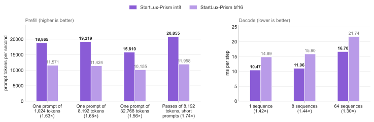
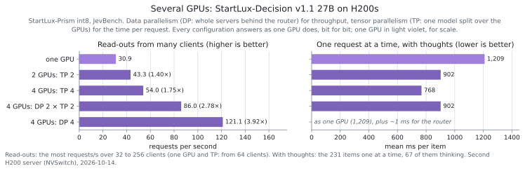

# Serving StartLux-Prism

Every request field, server flag and model folder StartLux-Prism serves. The short version is in the [README](../README.md).

## StartLux-Decision v1.1 folders

The server reads a model folder's kind as v1.1's own package does (`startlux_prism/modelcfg.py`) and answers as that
release does:

| folder | how it answers | run here |
|---|---|---|
| v1 (`"format": "StartLux-Decision-v1"`) | in one pass, exactly as before v1.1 support | 4B, 9B, 27B |
| v1.1 AutoThink | one pass, then a thought when the first read-out is unsure | 27B: int8, bf16 and W4A8; 9B: int8 and W4A8 |
| v1.1 Instant (prompt read bidirectionally) | not served yet: refused at start-up | |

- **Thoughts.** `think_mode` `auto` (the default) thinks when the first read-out's top probability is below `gate`
  (0.6; the published numbers used 0.9). `never` answers in one pass, and `always` thinks first.
  - **Sampling:** as v1.1 samples a thought: temperature 0.6, top-k 20, top-p 0.95, a seed from the prompt, at most
    4,096 tokens, and v1.1's loop detector.
  - **Answer:** a second read-out of the prompt and the thought, mixed 0.25 / 0.75 with the first.
  - **Generation:** on the GPU, as decode steps recorded as CUDA graphs for up to 64 sequences, interleaved with the
    prefill batches.
- **None of the above.** With `none_check` (on by default for v1.1), every choice question gets the extra option "None
  of the above". Its probability is reported as `none_probability`, and the listed options are renormalised.
  `allow_none` (on by default for v1.1) also lets the choice be null when that option wins. We suggest treating a
  `none_probability` of 0.2 or more as "no listed option fits": it catches about two thirds of the questions whose
  right answer was removed, for about 2% of ordinary questions.
- **Images.** With the folder's `mmproj` vision file, a request can carry up to 8 images, placed, resized and
  positioned as v1.1 does. Thoughts read them too.
- **The same answers as v1.1's package.** Prompts match byte for byte, decisions from the same letter logits match to
  the float, and whole requests with thoughts match its pipeline ([Correctness](testing.md#correctness)).

Files run here: `StartLux-Decision-v1.1-27B-AutoThink-Q8_0.gguf` (28.60 GB, SHA-256 `28757be9a8fae525...`) and
`mmproj-StartLux-Decision-v1.1-27B-AutoThink-F16.gguf` (0.93 GB, `b6ff3c746a642ac4...`), from
`startlux-models/StartLux-Decision-v1.1-27B-AutoThink-GGUF`.

## Precisions and setup

**Precision** (`--precision`): `int8` (W8A8, the fast path: the default for Q8_0 files), `bf16` (the same weights
dequantized, on cuBLAS: the reference) or `w4a8` (a Q4_K_M file's own 4-bit weights: its default).

**Several GPUs** (the same flags):

```bash
python -m startlux_prism.server --tp 2 --gpus 0,1 --gguf $G --model-dir $M --port 8092    # tensor parallel: faster requests
python -m startlux_prism.dp --gpus 0,1,2,3 --gguf $G --model-dir $M --port 8092           # data parallel: most throughput
python -m startlux_prism.dp --gpus 0,1,2,3 --tp 2 --gguf $G --model-dir $M --port 8092    # both: two 2-GPU servers
```

Requests go to port 8092 as before, and every answer is the single GPU's, bit for bit. Tensor parallelism runs int8,
on 2 or 4 GPUs for the 27B. Its first start measures the activation ranges on its first GPU (that GPU must hold the
bf16 weights for it: 54 GB for the 27B), then splits the model; nothing has to run on one GPU beforehand.

On the benchmark servers (no internet), `scripts/setup_server.sh` installs wheels fetched elsewhere into `~/jev/venv`
with the pip CUDA 13 toolkit as `CUDA_HOME` and writes `~/jev/env.sh`; then
`MODEL=~/jev/models/StartLux-Decision-4B-Q8_0-GGUF scripts/serve.sh start int8` starts a server on port 8092 and
`scripts/serve.sh stop` stops it.

## What a start prints

Each loading step on a line of its own with the time; the weights layer by layer and the CUDA graphs batch shape by
batch shape (on a terminal the count is redrawn in place, in a log there is a line at each quarter); then `Ready`, the
endpoints and a request to try, which can be pasted as it is. The 9B in int8 on an RTX 4090, its CUDA extension built
and its activation ranges saved by an earlier start (counts shortened, the ranges file's path too):

```text
[01:39:25] StartLux-Prism: StartLux-Decision-v1.1-9B-AutoThink-Q8_0.gguf (v1.1 AutoThink) as int8 on NVIDIA GeForce RTX 4090 (sm_89, 24 GiB)
[01:39:26] reading the model file (9.5 GB)
[01:39:39] weights to the GPU (bf16): 8/32 layers
[01:39:40] weights to the GPU (bf16): 32/32 layers (1.0 s)
[01:39:40] int8 activation ranges: ~/.cache/startlux-prism/calib/...
[01:39:41] int8 weights (SmoothQuant): 8/32 layers
[01:39:42] int8 weights (SmoothQuant): 32/32 layers (2.3 s)
[01:39:43] buffers: batches up to 16,384 tokens, prefix cache 64 entries, 4 thoughts at once; GPU memory 19.1 of 23.6 GiB in use (17.7 s so far)
[01:39:44] CUDA graphs (a first start also compiles the Triton kernels): 8/31 batch shapes
[01:39:44] CUDA graphs (a first start also compiles the Triton kernels): 31/31 batch shapes (0.9 s)
[01:39:46] decode graphs (thoughts): 3/3 batch sizes (0.2 s)
loaded in 17.7 s, graphs recorded in 3.1 s; max 16384 tokens per batch; GPU memory 20.2 of 23.6 GiB in use
Ready: http://127.0.0.1:8092/v1/systemone (int8), started in 22.4 s
  POST http://127.0.0.1:8092/v1/systemone   decisions (the TypeSafe System One API)
  GET  http://127.0.0.1:8092/health         status and limits
  GET  http://127.0.0.1:8092/v1/models      the model served
  AutoThink: think_mode "auto" unless a request sets "think_mode" ("never", "auto" or "always"); "return_details": true adds the thought's details
Try it:
  curl -s http://127.0.0.1:8092/v1/systemone -H 'Content-Type: application/json' -d '{
    "state": {"ticket": "I was charged twice for order #4411 and the app still shows it as unpaid."},
    "questions": {
      "team": {"type": "choice", "instructions": "Which team should handle this ticket?",
               "criteria": {"billing": "Payments and refunds", "shipping": "Delivery", "technical": "App and login"}},
      "urgent": {"type": "noul", "instructions": "Should this ticket be answered today?"}}}'
```

- **A first start** also measures the int8 activation ranges (`int8 activation ranges: computing them`, the
  calibration requests counted, then where they are saved for the next starts) and, the first time on a GPU model or
  after the CUDA sources change, compiles the CUDA extension: `CUDA kernels: compiling the extension for sm_89 - the
  first start with this GPU and these sources, a few minutes`, then the time it took and where it is kept (4 minutes
  on the RTX 4090, 3 on an A800).
- **`--host 0.0.0.0`**: the endpoints and the example still use 127.0.0.1, and a line says how other machines reach the
  server and that it has no authentication or TLS.
- **`startlux_prism.dp`**: the workers' steps go to their logs (`--log-dir`); the router says where they are, shows
  the last line of a worker still starting every 20 s, says when each is ready, then prints its own `Ready` and the
  same endpoints and example.

The `loaded in` and `Ready: http://...` lines keep their form for scripts that wait for them.

## Running as a service

Installed as in the README ([Install](../README.md#install)):

- **Address.** The server listens on `127.0.0.1:8092`; `--host 0.0.0.0` (and `--port`) serve other machines. It has no
  authentication or TLS of its own: put it behind your gateway.
- **Ready.** `GET /health` answers once the model is loaded and its graphs recorded.
- **Caches.** The first start compiles the CUDA kernels (into `TORCH_EXTENSIONS_DIR`, by default
  `~/.cache/torch_extensions`) and the Triton kernels (`TRITON_CACHE_DIR`, by default `~/.triton/cache`), and measures
  the int8 activation ranges (`~/.cache/startlux-prism/calib`, a file per model). Keep the three on a persistent disk
  (in a container: volumes), and later starts skip that work.
- **Several GPUs.** `python -m startlux_prism.dp --gpus ...` runs a server per GPU behind one port (above);
  `CUDA_DEVICE_ORDER=PCI_BUS_ID` makes the GPU numbers nvidia-smi's.
- **systemd**, the repository in `/opt/StartLux-Prism` and a model in `/models/M` (installed from
  `requirements-cu12.txt`: `Environment=CUDA_HOME=/usr/local/cuda` in place of `source scripts/cuda_env.sh`):

```ini
[Unit]
Description=StartLux-Prism
After=network-online.target

[Service]
WorkingDirectory=/opt/StartLux-Prism
Environment=CUDA_DEVICE_ORDER=PCI_BUS_ID
ExecStart=/bin/bash -c 'source .venv/bin/activate && source scripts/cuda_env.sh && exec python -m startlux_prism.server --gguf /models/M/model.gguf --model-dir /models/M --host 0.0.0.0 --port 8092'
Restart=on-failure

[Install]
WantedBy=multi-user.target
```

## Models, GPUs and precisions

| `--precision` | weights | activations | used for |
|---|---|---|---|
| `int8` (W8A8) | int8 per output channel, requantized from the GGUF with SmoothQuant at start-up | int8 per token | Q8_0 files (`auto`) |
| `w4a8` | the file's own Q4_K / Q6_K blocks, as stored | int8 per 256 inputs | Q4_K_M files (`auto`) |
| `bf16` | dequantized from the GGUF, cuBLAS | bf16 | the parity reference |

Measured:
- **RTX 5090:** the 4B and 9B (Q8_0: int8 and bf16; Q4_K_M: W4A8) and the 27B's Q4_K_M (W4A8); v1.1 AutoThink with
  thoughts: the 9B (Q8_0: int8; Q4_K_M: W4A8) and the 27B (Q4_K_M: W4A8).
- **RTX 4090:** v1.1 AutoThink with thoughts, the 9B (Q8_0: int8; Q4_K_M: W4A8).
- **A800:** v1.1 AutoThink with thoughts, the 27B (Q8_0: int8; Q4_K_M: W4A8).
- **H200:** the v1 27B (Q8_0: int8 and bf16; Q4_K_M: W4A8 and int8); v1.1 AutoThink with thoughts: the 27B (Q8_0:
  int8 and bf16, int8 on 2 and 4 GPUs; Q4_K_M: W4A8) and the 9B (Q4_K_M: W4A8).
- **Several GPUs:** data parallelism with any precision (`startlux_prism.dp`); tensor parallelism with int8, 2 or 4 GPUs on
  the 27B (`--tp`); both together (`startlux_prism.dp --tp 2`).

To add another model of the family, run `scripts/prepare_model.sh` (its folders for every engine), then
`scripts/new_model.sh` (dispatch-table entries for its projection shapes, int8 calibration, correctness tests).

### int8 or bf16

Both paths run the same Q8_0 weights, dequantized to bf16 or requantized to int8:

<picture>
  <source media="(prefers-color-scheme: dark)" srcset="images/v11-precision-dark.svg">
  
</picture>

- **Speed:** int8 is 1.44-1.75x faster in prefill and 1.25-1.44x in decode.
- **Through the server:** JevBench runs at 30.7 requests/s from 64 clients, against 16.9 for bf16.
- **Accuracy:** one-pass answers score the same. Thoughts written by bf16 are slightly more accurate (226.2 against
  220.5 correct per pass of 231).

StartLux-Decision v1 files: Every file is byte-identical to StartLux's release of 2026-09-29 (SHA-256 checked on 2026-10-13). The files and their SHA-256: [benchmarks.md](benchmarks.md#setup).

## Endpoints, request fields and server flags

Endpoints: `POST /v1/systemone` (also `POST /v1/decisions`), `GET /v1/models`, `GET /health` (the folder's kind and
the defaults) and `GET /stats` (batches, prefix-cache hits and evictions, how thoughts ended).

Request fields (the TypeSafe / StartLux-Decision format; the v1.1 fields as its package defines and validates them):

| field | default | effect |
|---|---|---|
| `state` | | the evidence: a string or any JSON value |
| `questions` | | `{key: {"type": "choice" \| "noul" \| "score", "instructions", "criteria"}}` |
| `images` | none | v1.1 with a vision tower: base64 strings or data URIs, at most `--max-images` (8), at the state's `<image>` marks or before it; each resized to at most `--max-pixels` (1,048,576) and read as one token per 32 x 32 pixels |
| `think_mode` | `auto` on AutoThink folders | `auto`, `never` or `always` |
| `gate`, `mix`, `think_budget` | 0.6, 0.75, 4,096 | the threshold to think (the published numbers used 0.9), the weight of the read-out after the thought, the longest thought |
| `none_check` | true on v1.1 folders | the extra option "None of the above" and `none_probability` |
| `allow_none` | true on v1.1 folders | `choice` is null when "None of the above" is the most likely option (also per question) |
| `return_details`, `return_thought` | false | per-answer read-outs and `timing_ms`, and the thought's text |

A malformed body gets 422 on v1.1 folders and 400 on v1 folders, as each release's own server answers.

Server flags:

| flags | default | |
|---|---|---|
| `--precision`, `--calib` | `auto`, `~/.cache/startlux-prism/calib/<file>-<size>-v1.pt` | the precision (above) and the int8 activation ranges (measured on the first start, before a `--tp` group splits the model too, and kept in this file; `$STARTLUX_PRISM_CACHE` moves the cache) |
| `--max-tokens`, `--mem-fraction` | 0, 0.9 | the largest batch; 0 sizes it from free GPU memory (65,536 tokens for the 4B on the RTX 5090, 131,072 for the 27B on the H200). Longer requests get HTTP 422 |
| `--budget` | 8,192 | tokens per batched pass when requests queue; a longer request runs alone |
| `--prefix-cache`, `--prefix-cache-tokens`, `--prefix-cache-min` | 64, 65,536, 64 | cached evidence states (0: off), their KV rows, the shortest evidence cached |
| `--none-check`, `--allow-none` | `auto` (on for v1.1) | the defaults of the request fields (`--allow-none` alone: on) |
| `--gate` | the folder's (0.6) | the default gate of AutoThink folders (the published numbers used 0.9) |
| `--think-mode`, `--max-think-budget`, `--think-seqs`, `--think-kv-rows` | the folder's, 4,096, auto, auto | thoughts: the default mode, the largest budget, thoughts generated at once (144 MiB of state each on the 27B; auto: the most, up to 64, whose state and KV rows take at most half of the GPU memory left after the weights and an 8,192-token batch's buffers - 64 for the 27B on an H200, 16 for the 9B in int8 on an RTX 5090) and their KV rows (think-seqs x (budget + 1,024)) |
| `--mmproj`, `--max-images`, `--max-pixels` | `auto`, 8, 1,048,576 | the vision tower (`auto`: the `mmproj-*.gguf` beside `--gguf`; `none`: text only); images need Pillow |
| `--graph-max-tokens`, `--no-graphs` | | CUDA graphs for every token bucket (recorded at start-up) or fewer |
| `--attn-qk8` | off | opt-in: q k^T on int8 tensor cores, 15% off at 50,000 tokens at a small probability error |
| `--tp`, `--gpus` | 1, the visible GPUs | tensor parallelism: one model over this many GPUs (int8; 2 or 4 on the 27B) |

**Several GPUs, data parallelism** (`python -m startlux_prism.dp --gpus ...`, the server's flags pass through):
- **Workers:** one whole server per GPU, each with its own prefix cache and thoughts; with `--tp N`, one
  tensor-parallel server per N GPUs.
- **Routing:** the router forwards every request whole to the worker that last answered the same evidence, unless
  that worker has more than `--affinity-slack` (2) requests in flight beyond the least loaded one; otherwise to the
  least loaded worker.
- **Failures:** a worker that fails is skipped until its `/health` answers again.

**One model over several GPUs, tensor parallelism** (`--tp N --gpus a,b,...`, the int8 path):
- **Sizes:** N divides the attention heads, kv heads, linear-attention key heads and FFN width: 2 or 4 on the 27B.
- **First start:** without the activation ranges, the server measures them first on the group's first GPU (a process
  of its own that loads the bf16 weights: 54 GB for the 27B), then starts the group.
- **Processes:** the server's process is rank 0 on the first GPU and starts one process per further GPU
  (`python -m startlux_prism.tp`, not run by hand), which replays its passes. If one of them dies, the server exits.
- **Memory:** each GPU holds 1/N of the projections, of the KV rows and of the recurrent states (72 MiB per thought at
  2 GPUs), so the buffers above are sized per GPU (the smallest GPU's choice; rank 0 also holds the vision tower).
- **Tuning:** `STARTLUX_PRISM_TP_FAST_ROWS` (16,384) and `STARTLUX_PRISM_TP_PULL_ROWS` (128 on 2 GPUs, 4 on 4) set the longest
  passes whose maxima and sums stay inside the kernels.

## Several GPUs: which to pick

Two ways to use more GPUs, both giving the single GPU's answers, bit for bit (27B v1.1 on H200s, int8, JevBench):
- **Data parallelism** (`python -m startlux_prism.dp`): one whole server per GPU behind a router. The most throughput; a
  request takes as long as on one GPU.
- **Tensor parallelism** (`--tp 2` or `4`): one model split over the GPUs. Less time per request, mostly for long
  prompts and thoughts.

<picture>
  <source media="(prefers-color-scheme: dark)" srcset="images/several-gpus-dark.svg">
  
</picture>

They combine (`startlux_prism.dp --tp 2`: tensor-parallel servers behind the router). Four H200s each way:

| four H200s as | read-outs, requests/s | with thoughts, requests/s | one at a time, mean ms: read-out / with thoughts |
|---|---|---|---|
| four one-GPU servers | **121.1** (3.92x one GPU) | **26.1** | one GPU's (41.0 / 1,209), plus the router's ~1 ms |
| two 2-GPU servers | 86.0 (2.78x) | 19.9 | 36.0 / 902 |
| one 4-GPU server | 54.0 (1.75x) | - | **29.0 / 768** |

Read-outs: the most over 32 to 256 clients (one 4-GPU server: from 64). With thoughts: 3,696 requests from 256
clients, long enough that the longest thought (about 4,000 tokens) is a small part of the run; not run on one 4-GPU
server.

Eight H200s against the official engine, each with its own data parallelism (StartLux-Prism int8; the official engine's
BF16 release, one vLLM server per GPU): read-outs 237.8 requests/s against 137.5 (1.73x), with thoughts 41.0 against
29.9 (1.37x; the same 3,696 requests from 512 clients). On one GPU the official FP8 setting is 1.44x its BF16; it was
not run on eight.

Tensor parallelism, two and four H200s on NVSwitch:

| | one GPU | two GPUs | four GPUs |
|---|---|---|---|
| prefill, one 8,192-token prompt, ms | 427.6 | 301.2 (1.42x) | **241.6** (1.77x) |
| prefill, one 256-token prompt, ms | 17.5 | 17.3 (1.01x) | **15.1** (1.16x) |
| a lone thought's decode step, ms | 10.47 | 7.68 (1.36x) | **6.51** (1.61x) |
| JevBench one at a time, read-outs, mean ms | 41.0 | 34.4 | **29.0** |
| JevBench one at a time, with thoughts, mean ms | 1,209 | 902 | **768** |
| read-outs from 64 clients, requests/s | 30.9 | 43.3 | **54.0** |
| with thoughts from 64 clients (462 requests), requests/s | 6.28 | 8.26 | **9.81** |

Short prompts gain little from tensor parallelism: each kernel's fixed cost does not divide among the GPUs, and the
sums and maxima exchanged between them take a fifth to a third of a pass on two GPUs and two fifths on four. Details:
[tensor parallelism](benchmarks.md#tensor-parallelism-the-27b-on-2-and-4-h200s),
[four H200s](benchmarks.md#four-h200s-the-most-throughput),
[eight H200s against the official engine](benchmarks.md#eight-h200s-against-the-official-engine),
[data parallelism on three](benchmarks.md#several-gpus-data-parallelism).
